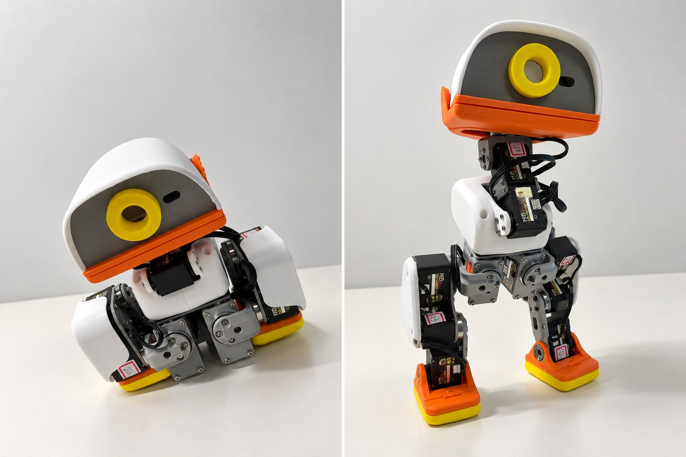

# Microduck 客户组装与调试教程

从清点零件、逐颗编号，到整机装配、标定和首次试走，按下面八章顺序完成。每章都有操作条件、具体步骤、合格标准和异常处理。

## 适用套件

电控主线：**瑞莎 Radxa ZERO 3W + 配套 HAT + 15 颗飞特 HD-1910-C001 TTL 舵机 + IMU to DXL 总线板（ID 200）+ 2S 电池或配套稳压电源**。摄像头、语音、手柄等在基本动作稳定后逐项启用。

本教程后文“HD1910”均指 **HD-1910-C001**。采购与装箱使用[本套硬件 BOM](bom/BOM-ZERO3W-HD-1910-C001-HAT.md)，不再使用 Arduino Uno Q 电控清单；HAT 型号/PCB 版号、线束与结构五金数量按实际批次登记。

先核对随货硬件与软件版本。接口相似不代表针序、供电和协议相同。本仓库的 Arduino Uno Q 资料用于结构参考，其电控 BOM 不能直接代替瑞莎方案。

Studio 是操作界面，真正管理舵机、IMU 和策略的是主控上的 `robotd`。仿真训练则在训练电脑上进行。

## 八章操作顺序

装配与接线合并为第 03 章，教程按 01–08 连续编号。

| 章节 | 操作内容 | 完成结果 |
| --- | --- | --- |
| [01-物料清单](docs/01-物料清单.md) | 核对硬件、线束、工具、配套文件 | 型号与版本明确、物料齐全 |
| [02-舵机编号与校准](docs/02-舵机编号与校准.md) | 单颗编号、统一速率、检查中位和真实转动 | 15 颗身份唯一、有记录的舵机 |
| [03-装配与接线](docs/03-装配与接线.md) | 机械装配、板卡固定、总线与电源接线 | 无干涉、无夹线，完成分段供电检查 |
| [04-烧录系统](docs/04-烧录系统.md) | 校验镜像、烧卡、配网、SSH、串口 | 稳定在线、可维护的主控 |
| [05-配置 Microduck Studio](docs/05-配置Microduck-Studio.md) | 服务、设备识别、模型包与回读 | 网页和主程序均有真实状态 |
| [06-标定 HOME 位与 IMU](docs/06-标定HOME位与IMU.md) | 零位、方向、IMU 验证、写入主程序 | 标定持久保存、进入运动模式 |
| [07-测试站立、坐下、走路等功能](docs/07-测试站立坐下与走路.md) | 卸力、站立、坐下、低速落地试走 | 有记录的实机功能验收 |
| [08-仿真训练](docs/08-仿真训练.md) | 训练、导出、回放、合同核对与部署 | 可追溯的模型和部署结果 |

全散件用户从 01 开始。已装好的整机也需核对 ID、装配和接线，再进入软件配置。第 02 章在电脑上使用外置调试板，不需要先刷瑞莎。使用已验证的配套模型时，不必先训练才能试走。

## 开始前记住四件事

1. **中位不等于 HOME。** 中位常为 2048，HOME 是与模型匹配的一组关节角，不能把“全部回 2048”当成站立命令。
2. **按钮按下不等于动作完成。** 同时检查主程序回读与实物；输出轴没动时，数字变化不能代替机械验收。
3. **接管总线前先卸力、扶稳。** 用 Studio 接管和交还，不让扫描脚本与 robotd 抢串口。停止或重启服务不能代替卸力确认。
4. **先基础功能，后扩展。** 摄像头先验证采图、编码、网页帧与联网稳定，再考虑自启动。采到一张照片不等于网页视频可用。

## 排查与记录

- [故障排查](docs/附录/故障排查.md)：扫不到设备、读不出姿势、主程序没回话、地上不走、SSH 断连。
- [接口与参数速查](docs/附录/接口与参数速查.md)：ID、针序、端口、文件位置。
- [装机与验收记录](docs/附录/装机与验收记录.md)：从开箱到试走的填写模板。
- [独立 I²C IMU 方案](docs/附录/独立I2C-IMU方案.md)：只供使用独立模组的套件，不与总线 IMU 接法混用。
- [摄像头扩展与网络恢复](docs/附录/摄像头扩展与网络恢复.md)：基本功能验收后再读。
- [资料来源与版本](docs/附录/资料来源与版本.md)：来源、硬件差异与验证范围。

教程整理完成不等于某台机器已经验收。镜像、运行时和模型须使用随货指定、版本匹配、适用于交付用途的组合。发布前尚需核定的具体版本、图片和实测项目列在维护用[发布核对表](维护/发布核对表.md)，不能用任意“最新版”代替。

## 来源与许可

在原有中文教程基础上重新组织，保留原图、资料和署名。本文档继续采用仓库 CC BY-SA 4.0 许可；硬件、软件、网格和模型分别遵循各自许可。见[致谢与许可](致谢与许可.md)。
