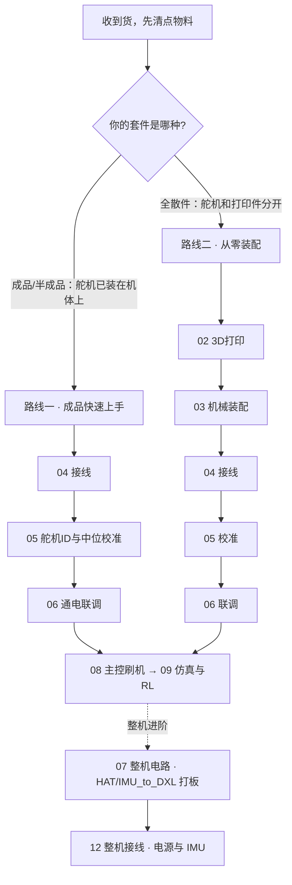

# MicroDuck 机器鸭 · 组装与调试中文教程

> 一只 25 cm、不到 1 kg、15 个自由度的开源双足机器鸭，能站、能走、能转头、会"说话"（开合鸭嘴），可以在板上跑强化学习（RL）步态策略。
>
> 本教程面向**拿到整套硬件的用户**，手把手带你从一堆零件（或一台半成品）走到"通电、联调、能动、会走"。内容涵盖**硬件装配、舵机调试、整机电路与自制板设计（HAT / IMU_to_DXL 打板）、主控刷机，以及仿真、步态与强化学习**。

  

装配完成的单腿模组（HD1910M 舵机 + 3D 打印结构 + TPU 脚底）。整机封面照可替换为 <code>assets/cover.jpg</code>。

---

## 这份教程能带你做什么

- 看懂整套物料：每个零件是干什么的、为什么是这个规格（[物料清单与工具](docs/01_物料清单与工具.md)）
- 把 3D 打印件和舵机拼成完整机体（[机械装配](docs/03_机械装配.md)）
- 把 15 个舵机、IMU、摄像头、控制板、电源正确接成一条总线（[电子接线与舵机总线](docs/04_电子接线与舵机总线.md)）
- 给每个舵机写好 ID、统一波特率、做中位（零点）校准（[舵机调试：ID 与中位校准](docs/05_舵机调试_ID与中位校准.md)）
- 通电自检、整机联调，让鸭子第一次动起来（[通电自检与联调](docs/06_通电自检与联调.md)）
- 从桌面调试走向整机：自己设计打样 **HAT 板 / IMU_to_DXL 板**（[整机电路与自制板设计](docs/07_整机电路与自制板设计.md)）
- 把电池、HAT、IMU 正确接起来：**哪个口接电池、IMU 板怎么挂、独立 IMU 模组怎么接主控**（[整机接线：电源与 IMU](docs/12_整机接线_电源与IMU.md)）
- 给主控刷系统、把总线和 IMU 跑通（[主控系统与刷机](docs/08_主控系统与刷机.md)）
- 在仿真里用强化学习训练步态、导出 ONNX 部署到真机（[仿真、步态与强化学习](docs/09_仿真步态与强化学习.md)）

---

## 先选你的路线

这套硬件有两种到手形态，装配工作量差别很大。**先确认你买的是哪一种**，再按对应路线走。

| 路线 | 适合谁 | 从哪一章开始 |
| --- | --- | --- |
| **路线一 · 成品快速上手** | 买的是**舵机已装好**的整机/半成品 | 直接从 [01 物料清单](docs/01_物料清单与工具.md) → [04 接线](docs/04_电子接线与舵机总线.md) 开始，跳过打印和机械装配 |
| **路线二 · 从零装配** | 买的是**全散件**（打印件、舵机、五金分开） | 从 [02 3D打印](docs/02_3D打印指南.md) 一路做到底 |

> 怎么判断？看肩、胯、膝、踝这些关节处的舵机：如果 15 个舵机已经被螺丝固定在打印件里、只差接线和校准，就是**成品/半成品**（走路线一）；如果舵机还在独立包装袋里，就是**全散件**（走路线二）。

---

## 目录

| 章节 | 内容 | 路线一 | 路线二 |
| --- | --- | :---: | :---: |
| [01 物料清单与工具](docs/01_物料清单与工具.md) | 整套物料逐项说明、工具准备、开箱清点 | ✅ | ✅ |
| [02 3D 打印指南](docs/02_3D打印指南.md) | 打印件清单、材料与参数、结构设计说明 | — | ✅ |
| [03 机械装配](docs/03_机械装配.md) | 腿 / 胯 / 躯干 / 头颈 / 下巴 / 脚 / 外壳分模组装 | — | ✅ |
| [04 电子接线与舵机总线](docs/04_电子接线与舵机总线.md) | 菊花链拓扑、ID 规划、针序、转接线、供电 | ✅ | ✅ |
| [05 舵机调试：ID 与中位校准](docs/05_舵机调试_ID与中位校准.md) | 用总线控制板改 ID、设波特率、做中位校准 | ✅ | ✅ |
| [06 通电自检与联调](docs/06_通电自检与联调.md) | 上电检查清单、整机扫描、动作自检 | ✅ | ✅ |
| [07 整机电路与自制板设计](docs/07_整机电路与自制板设计.md) | HAT 板打板、IMU_to_DXL 板设计、整机配电（进阶） | 进阶 | 进阶 |
| [08 主控系统与刷机](docs/08_主控系统与刷机.md) | Radxa RK3566 刷机、释放 UART/I²C、板上读总线与 IMU | ✅ | ✅ |
| [09 仿真、步态与强化学习](docs/09_仿真步态与强化学习.md) | MuJoCo/Isaac 仿真、PPO 训练、BAM、导出 ONNX 部署 | ✅ | ✅ |
| [10 常见问题 FAQ](docs/10_常见问题FAQ.md) | 总线扫不到、抖动、过热、开嘴难等排错 | ✅ | ✅ |
| [11 接口与参数速查](docs/11_接口与参数速查.md) | ID 表、针序、波特率、寄存器、接口对照 | ✅ | ✅ |
| [12 整机接线：电源与 IMU](docs/12_整机接线_电源与IMU.md) | 电池接 HAT 哪个口、IMU_to_DXL 怎么挂、独立 IMU 模组接主控（整机） | 进阶 | 进阶 |

---

## 整机一句话原理

把复杂的东西说简单：

- **身体**：3D 打印外壳 + 15 个总线舵机（关节）。腿每条 5 个（髋 yaw/roll/pitch + 膝 + 踝），头颈 4 个，鸭嘴 1 个。
- **大脑**：一块 RK3566 级别的 Linux 主控（如 Radxa ZERO 3W）。它以 **50 Hz** 的节拍读取所有关节和 IMU 的状态，算一步，再把目标角度发回舵机。
- **怎么会走**：走路的"步态"不是写死的代码，而是一个在电脑/服务器上用强化学习训练出来、再导出成 **ONNX** 的小模型；主控每一拍跑一次这个模型。**换了舵机就必须重新训练**，官方模型不能直接拿来当即插即用的步态。
- **调试阶段（本教程重点）**：主控和舵机控制板先放在机体外面，用电源适配器供电、数据线连电脑，把每个舵机的 ID、零点、通信都先调通。这一步做扎实了，后面塞进机体跑整机才不翻车。

更细的架构见 [11 接口与参数速查](docs/11_接口与参数速查.md)、[08 主控系统与刷机](docs/08_主控系统与刷机.md) 和 [09 仿真、步态与强化学习](docs/09_仿真步态与强化学习.md)。

---

## 致谢与来源

本教程的硬件知识与结构设计，整理、复述并再创作自社区开源项目 **OpenMicroDuck**（基于 Hugging Face / Pollen Robotics 的 **MicroDuck** 复刻）。原始项目把图纸、PCB、BOM、软件栈、训练环境全部公开，是这份中文教程得以存在的前提。

- OpenMicroDuck 项目：https://github.com/JoyandAI/OpenMicroDuck
- 上游 MicroDuck（Pollen Robotics）：https://pollen-robotics.com/microduck/
- 适配 HD-1910 的 RL 训练 fork：https://github.com/JoyandAI/microduck_rl （`develop` 分支）

本教程为独立编写的中文装配/调试文档，与上述团队无隶属关系。详见 [致谢与许可](致谢与许可.md)。

## 许可

本教程文档沿用上游 **CC BY-SA 4.0**：你可以自由复制、修改、再分发，但需署名来源、并以相同许可共享。硬件图纸、PCB、BOM 的许可以上游项目为准（CERN-OHL-S / Apache-2.0）。
