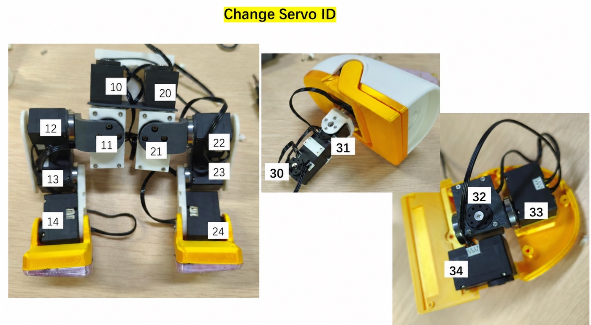

# 02-舵机编号与校准

[返回首页](../README.md) · 上一章：[物料清单](01-物料清单.md) · 下一章：[装配与接线](03-装配与接线.md)

**目标：**装配前逐颗确认 ID、波特率、中位与输出轴真实动作。整机装好后，还要按第 06 章复核零位、方向并写入主程序。

本章舵机型号固定为 **飞特 HD-1910-C001**，不再将 C018 或其他后缀作为同一采购项。规格与出厂参数依据 C001 厂家资料，实际固件版本仍逐颗读回登记。

操作方法参考[飞书《4.4 配置舵机 ID》](https://scnh0ytb81fx.feishu.cn/wiki/RJF3wqk6OiQIv6kwNGCc8wNonbf)，并按本套 Microduck 硬件改写。原文面向 SO101 机械臂，软件截图及 Python 示例使用 STS3215；本章保留 Microduck 的关节编号和 C001 参数，不使用原文机械臂的 1–6 编号。

**本章推荐顺序：**准备调试板和电源 → 找到串口 → 只接一颗 → 搜索并读取 → 改 ID → 断电复查 → 回中位、小幅点动 → 贴标签 → 下一颗 → 分组复查。首次操作建议使用 Windows 飞特调试软件，编号完成后可用配套 Studio 复核。

## 1. 先分清三个概念

| 名称 | 作用 | 何时做 |
| --- | --- | --- |
| ID | 在同一总线上找到指定舵机 | 装配前单颗完成 |
| 中位/机械零位 | 让物理装配基准对应软件关节零角；本教程采用中位 2048 的流程 | 装配前建立基准，装好后复核 |
| HOME | 运行时和模型约定的一组准备角度，不要求所有读数都是 2048 | 整机标定后核对 |

裸舵机转到 2048 只是装配准备，不能据此宣布整机 HOME 已标好。

## 2. 台架连接与软件准备

### 2.1 准备工具并连接单颗舵机

准备电脑、USB 数据线、支持该 C001 固件的半双工 TTL 舵机调试板、匹配的外接电源，以及标签纸。普通 USB-UART 不直接代替三线舵机调试板。此时不需要瑞莎已刷机，也不连接整机 HAT 或 IMU。

```text
电脑 ── USB 数据线 ── 半双工 TTL 舵机调试板 ── 一颗 HD-1910-C001
                              │
                        匹配的外接电源
```

1. 断开调试板和舵机电源，按板卡说明确认供电入口、跳线和 TTL 端口。
2. 按 **DATA、VCC、GND** 核对两端定义，再接一颗舵机；不依赖线色或插头能否插入判断兼容。
3. 用数据线将调试板接到电脑，再按板卡说明接通外接电源。
4. 将舵机外壳固定好，输出轴附近留出空间。暂不连接腿部承力机构，不把电线绕在输出轴上。

USB 能识别调试板，不代表舵机已经获得供电。每次换舵机或调整线束都先断电；如调试板存在 USB 向舵机供电的路径，也要按板卡说明断开，不能只关闭其中一路。

### 2.2 选择调试软件

| 工具 | 本章用途 | 使用条件 |
| --- | --- | --- |
| Windows 飞特调试软件 | 首次搜索、改 ID、读取参数和点动 | 使用随货提供或厂家确认支持当前 C001 固件的版本 |
| Linux Qt 调试工具 | 已有 Linux 环境的替代入口 | 先核对协议、型号和参数表支持情况 |
| Microduck Studio 台架模式 | 编号后的扫描、点动和中位复核 | 使用配套版本，详见第 7 节 |
| LeRobot / 自写 Python 脚本 | 本章不作为默认改号路径 | 原文针对 SO101 / STS3215，需完成 C001 适配后才能写参数 |

原文提供的 Windows 下载入口为[飞特 fddebug 仓库](https://gitee.com/ftservo/fddebug)，示例包为 `FD1.9.8.5(250729).7z`；Linux 入口为 [FT_SCServo_Debug_Qt](https://github.com/Kotakku/FT_SCServo_Debug_Qt)。这些是原文的软件线索，不代表该版本已经在本套 C001 上完成验证。优先使用随货确认的版本，记录软件版本和舵机固件。

Windows 下载后先完整解压，再运行其中的程序；按调试板 USB 芯片型号安装驱动。不要仅凭别人的截图就认定自己的板子也是 CH340，或把 STS3215 的参数表强行选给 C001。

### 2.3 找到真实串口

先在舵机断电状态下比较调试板 USB 插入前后的设备列表，确认新增设备。插拔时若会改变舵机供电，仍按断电流程处理。

| 电脑系统 | 查找方法 | 常见显示形式，仅作示例 |
| --- | --- | --- |
| Windows | 设备管理器 → 端口（COM 和 LPT），比较调试板插入前后 | `COM3`、`COM6` |
| macOS | 终端列出 `/dev/cu.*`，比较插入前后 | `/dev/cu.usbserial-…`、`/dev/cu.usbmodem…` |
| Linux | 查看串口设备与稳定设备链接，比较插入前后 | `/dev/ttyUSB0`、`/dev/ttyACM0` |

```bash
# macOS 电脑
ls /dev/cu.*
```

```bash
# Linux 电脑；无对应设备时可能提示路径不存在
ls -l /dev/serial/by-id/
ls -l /dev/ttyUSB* /dev/ttyACM*
```

如果没有新增串口，先检查数据线、驱动和 USB 连接。出现权限错误时按当前系统配置串口访问权限，不通过反复搜索 ID 解决。这里选择的是**电脑上的 USB 调试板串口**，不是瑞莎上的 `/dev/ttyS2`。

打开飞特软件前关闭 Studio、串口助手和其他可能占用该口的程序。一块调试板同一时间只交给一个程序。

## 3. ID 对照表

左右按**鸭子自身面向前方时**定义。人站在它对面时，视觉左右相反。

| ID | 部位 | 运动含义 |
| --- | --- | --- |
| 10 | 右髋 yaw | 右腿绕竖直方向转动 |
| 11 | 右髋 roll | 右腿侧摆 |
| 12 | 右髋 pitch | 右腿前后摆 |
| 13 | 右膝 | 右膝屈伸 |
| 14 | 右踝 | 右脚俯仰 |
| 20 | 左髋 yaw | 左腿绕竖直方向转动 |
| 21 | 左髋 roll | 左腿侧摆 |
| 22 | 左髋 pitch | 左腿前后摆 |
| 23 | 左膝 | 左膝屈伸 |
| 24 | 左踝 | 左脚俯仰 |
| 30 | 脖 pitch | 整个头颈前后俯仰 |
| 31 | 头 pitch | 头部俯仰 |
| 32 | 头 yaw | 左右转头 |
| 33 | 头 roll | 头部侧倾 |
| 34 | 鸭嘴 | 开合 |
| 200 | IMU to DXL | 传感器地址，不按舵机校准 |



图源：仓库内 HD1910 装配 PDF 第 1 页，腿部 ID 标注已按本教程更正；电控接线以第 03 章为准。

## 4. 单颗改 ID，断电复查

以下以把一颗新舵机设为 **ID 10（右髋 yaw）** 为例。其余舵机重复相同流程，目标 ID 按第 3 节逐颗替换。

### 4.1 打开串口并搜索

1. 确认总线上只有这一颗舵机，外接电源已正常接通。
2. 在软件“端口号”选择刚确认的串口，不照抄原文截图的 `COM6`。
3. 将通信波特率选为 **1000000（1 Mbps）**。本套通信格式为 **8N1**；软件有校验位选项时选择 `NONE`。
4. 点击“打开”。原文截图按钮显示“关闭”，表示该截图中串口已经打开；以自己软件的连接状态为准。
5. 点击“搜索”，等待设备列表更新。C001 规格书的出厂值为 ID 1、1 Mbps；使用过的舵机可能已经改号或改速率。
6. 点击搜索结果中的这颗设备，核对“当前选中 ID”、型号/固件和实时反馈。原文截图显示 `STS3215`，本套应核对实际 C001 的识别结果，不能因为搜索到了设备就忽略型号支持问题。

**应看到的结果：**列表只有预期的一颗设备，选中后能持续读取状态。没有搜到时先按第 9 节排查；还未稳定读取，不进入写参数步骤。

### 4.2 保存原始设置

在软件支持的参数页读取并记录：当前 ID、波特率、固件、运行模式、电子零偏及位置限位。支持导出就导出，不支持则保存清晰截图。暂时读不出的字段写“未读到”，不要猜填。

这一份记录用于区分原有设置和本次改动。第一次先完成改 ID；不要同时改零偏、模式、增益与限位，否则失败后难以判断是哪项引起。

### 4.3 写入新 ID

1. 固定舵机，确认已卸力；在原文所示软件中进入“编程”页。不同版本的参数页与按钮名称可能不同。
2. 读取当前设备参数，找到 **ID / 舵机 ID** 字段，确认编辑对象仍是原来的 ID 1。
3. 将目标值改为 **10**，只写入该项。若软件要求 EEPROM 解锁、写入及重新锁定，按当前 C001 固件和软件的配套说明执行。
4. 等待写入结果，不在写入期间断电、拔线或切换设备。
5. 重新搜索，选择 **ID 10**，再读取参数。ID 生效后旧地址可能不再响应，不应继续对旧 ID 1 重复写入。

**应看到的结果：**新搜索列表与参数回读均显示 ID 10。输入框里出现“10”或提示发送成功，还不能代替新地址读回。

### 4.4 核对波特率

本教程统一使用 **1,000,000 bps**。新舵机当前已为 1 Mbps 时直接保留，不需要反复写入。

已有舵机速率不同，则先在其当前速率下建立通信，按配套软件修改舵机端波特率并保存，再把电脑软件的通信速率切到 1 Mbps，重新搜索目标 ID。**只修改软件左侧的通信波特率，不等于修改了舵机内部设置。**

有些参数页把波特率显示为枚举值。使用该型号对应的选项或说明，不把 `1000000` 直接填进未知的寄存器数值栏。ID 与波特率分开修改，每次都读回确认。

### 4.5 断电后再验一次

1. 确认卸力，关闭软件串口，按调试板供电路径彻底断开舵机电源。
2. 重新上电，在软件中以 **1 Mbps** 打开串口并搜索。
3. 确认只有这颗目标 ID 10，重新读取位置及已保存参数；不以断电前的列表或曲线为证据。
4. 在记录表中填入原 ID、新 ID、波特率和断电复查结果。
5. 完成第 5 节的中位与点动检查后，贴上“10／右髋 yaw”标签，断电取下，放到已完成区域。

若重上电后恢复 ID 1，说明本次修改尚未通过持久保存检查，先核对写入和锁定流程。同 ID 的出厂舵机不能同时挂上去改号，不使用广播批量写 ID。

### 4.6 已装好时交换两个 ID

优先断电拆分为单颗处理。若必须在已知且无重复 ID 的总线上交换，先卸力、停控制，保证只有一个程序管理总线，并确认所用临时 ID 被当前固件允许且无设备占用；不能用 IMU 的 200。

按 `A → 临时 ID`、`B → A`、`临时 ID → B` 逐次写入，每次都用写入后实际生效的地址读回，再断电复查。不能直接把 A 改成已被 B 占用的地址。若已经出现重复 ID，断电隔离成单颗，不依靠广播修复。

## 5. 检查中位与真实动作

### 5.1 先核对模式，再发目标

固定裸舵机外壳，选择刚完成编号的 ID，确认输出轴周围无杂物、线材和承力机构。使用该 C001 固件已验证的位置控制功能、速度和加速度参数。原文截图中的速度、加速度、扭矩数值只是 STS3215 示例，不作为 C001 推荐值；尤其不能假设“速度 0”就是低速。

原文“调试”页包含“目标”“设置”“扭矩输出”和位置滑块。按当前配套版本确认使能与写目标的顺序，确保首次使能时使用的是准备发送的目标，而不是上一次残留值。不要直接拖动全行程滑块或启动自动往返扫描。

### 5.2 回到中位 2048

1. 在当前位置已知、裸轴可自由运动的条件下，将目标位置设为 **2048**，按配套流程使能并发送。
2. 同时看实际输出轴和位置回读，确认它运动到目标附近并稳定。目标栏是命令，反馈栏才是读回，两者分别核对。
3. 若读回不更新、输出轴不动、反复抖动或异常发热，先卸力检查，不继续增加动作。

这一步叫“回中位”，是让舵机运动到已有坐标的 2048；它不等于“把当前位置重新定义成中位”。

### 5.3 小幅往返，确认真实转动

1. 在输出轴或舵盘上做可移除的对位标记。
2. 从 2048 附近分别做约 **3–5°** 的小幅运动，每次等动作完成再发下一目标。仅对确认采用 4096 计数/圈的裸轴位置接口，3–5° 约合 34–57 个计数；例如可从 `2048 → 2082 → 2048 → 2014 → 2048` 开始。接口单位不是原始计数时，不能照填这些数字。
3. 观察真实转动方向、是否能回到原标记，以及有无异响、卡滞和持续抖动。裸轴方向记录留待整机与模型复核，不凭左右镜像猜方向配置。
4. 完成后卸力，确认输出不再保持，再断电。装配中如果轴被转动，安装舵盘前重新确认中位，不用手强扳正在保持的轴。

**回读变化、输出轴不动时，本颗不通过。** 核查演示模式、ID、舵盘固定、控制模式、保护状态；不要靠提高增益和反复上力排查。

资料包中 HD-1910-C001 规格书与 HLS 控制表不能自动视为同一固件。位置、速度、零偏、扭矩和电流寄存器只按当前型号对应文档使用。

C001 规格书还包含模式 4“纯位置 PD（Sim2Real）”，并标为出厂默认。调试软件与机器人运行时必须支持实际固件；不能拿仅列模式 0–3 的其他系列控制表覆盖其运行模式，也不能把“发位置数字”当成已核对模式。

## 6. 什么时候做“中位校准”

| 操作 | 实际含义 | 本教程安排 |
| --- | --- | --- |
| 写目标 2048 | 运动到已有中位，通常不改变零偏 | 本章裸舵机检查与装配准备 |
| 中位校准 | 将约定机械基准对应到中位，可能写入持久偏移 | 机械基准明确后按配套向导完成 |
| HOME 检查 | 多个关节进入模型约定的准备角度 | 第 06 章整机标定后完成 |

**第一次做散件装配：**先用本章“回中位”建立舵盘安装基准，再按第 03 章装配。裸舵机没有整机机械基准时，不为了完成一个按钮操作就把任意轴位置设成新的零位。

**整机装好或需要重新校零时：**按第 06 章执行下面的流程：

1. 先保存已有零偏和标定记录，托稳、卸力，再由 Studio 接管总线。
2. 对照配套机械零位图摆正对应关节；大偏差先检查错齿、左右件和 ID。
3. 逐颗预览中位校准值，确认后写入并重新读取。参考版 Studio 校准后会保持关节，继续手工摆姿态前必须再次卸力。
4. 检查真实机械基准、读回位置和方向，再完成整机 IMU、主程序写入及重启复查。

如果使用飞特软件的中位校准入口，必须先确认它对当前 C001 固件的具体作用、扭矩要求和保存方法。原文链接没有提供 C001 中位校准的完整界面步骤，本章不把其他型号的快捷按钮或寄存器写法当作已验证流程。

不要把任意自然站姿或 HOME 曲腿姿态设成全部 2048，也不要无记录地清掉已有偏移或叠加另一份软件零偏。

## 7. 可选：用 Microduck Studio 台架模式复核

先在飞特软件中卸力、关闭串口并退出程序，再启动 Studio。解压完整的配套 `software/studio`，在含 `run.py` 的目录运行；本教程参考版要求 Python 3.13：

```powershell
# Windows 电脑
py -3.13 -I run.py --bench
```

```bash
# macOS / Linux，已安装 Python 3.13 时
python3.13 -I run.py --bench
```

1. 根据程序输出打开本地网页，选择真实调试板串口和 1 Mbps。
2. 连接后读取该颗目标 ID，核对标签、位置反馈和实际设备。
3. 使用配套版本的小幅点动功能复核，完成后卸力并断开连接。

**“演示/没接舵机”是模拟设备，不能用于验收。** 某些版本的关节选择器只覆盖标准 ID；全网扫描发现出厂 ID 1，不代表界面一定能选它改号。此时回飞特工具完成初始编号，不猜选另一颗关节。

电脑台架模式不需要瑞莎已刷机；整机服务安装见第 05 章。

## 8. 15 颗完成后，分组复查与记录

先将每颗放入“待处理／已通过／异常待查”对应区域。只有已完成单颗改号和断电复查的舵机才加入分组总线。

| 分组 | 预期 ID | 数量 |
| --- | --- | --- |
| 右腿 | 10、11、12、13、14 | 5 |
| 左腿 | 20、21、22、23、24 | 5 |
| 头颈与嘴 | 30、31、32、33、34 | 5 |

1. 每次断电接入一组，核对调试板、线束和电源能满足当前连接数量。保持卸力，只做搜索和读取，不让整组同时运动。
2. 比较搜索结果与表格，逐颗确认标签和身份，连续读取数次位置。数量正确还不够，必须是正确的那几个 ID。
3. 单组通过后再按供电和布线条件合并验证全部 15 颗。调试台不具备整组供电条件时，将整组检查记为“待整机复查”，在第 05 章完成。
4. 若新增一颗后整组读数异常，断电移除新增设备，再单颗检查其 ID、速率和线缆。重复 ID 可能表现为超时或数据异常，并不一定在列表里显示两次。

本章台架不接 IMU，预期是 15 颗舵机；整机接上 ID 200 的 IMU 后才是 16 个设备地址。

每颗至少留下一行记录，可配合[装机与验收记录](附录/装机与验收记录.md)保存：

| 目标 ID／部位 | 原 ID／波特率 | 固件／软件版本 | 写入后回读 | 断电后回读 | 中位与真实点动 | 参数备份／异常 |
| --- | --- | --- | --- | --- | --- | --- |
| 10／右髋 yaw | 待填写 | 待填写 | 未测 | 未测 | 未测 | 待填写 |

这是一行填写模板，不是测试结果。按第 3 节为其余 14 颗补行；未测试填“未测”，失败保留原始现象。

## 9. 本章常见问题

| 现象 | 先做什么 | 何时继续 |
| --- | --- | --- |
| 串口列表里没有调试板 | 查 USB 数据线、驱动及插入前后设备变化 | 能确认真实串口后 |
| 打不开串口或提示占用 | 关闭飞特软件以外的串口程序，核对访问权限 | 串口可正常打开后 |
| 串口打开了，搜不到舵机 | 查外接电源、TTL 接法、当前速率，保持单颗测试 | 可以稳定读取后 |
| 改 ID 后旧地址不回应 | 在新 ID 搜索并读取；若同时改过速率，按已记录速率复查 | 新 ID 与实际设备一致后 |
| 断电后恢复旧 ID | 核对型号支持、写入结果和 EEPROM 保存流程 | 重新断电验证通过后 |
| 回读变化，输出轴不动 | 排除演示模式，查舵盘连接、模式、扭矩与保护状态 | 实际小幅运动通过后 |
| 单颗都正常，串联异常 | 逐段查重复 ID、线缆、退针和供电 | 每组持续回读通过后 |
| 回 2048 后结构不正 | 区分裸轴中位和整机机械零位，查装配错齿及原有偏移 | 按机械零位图复核后 |

## 10. 本章验收

- [ ] ID 恰为 10–14、20–24、30–34，无重复、漏项。
- [ ] 每颗有标签，断电后仍能以新 ID、1 Mbps 通信。
- [ ] 每颗输出轴已真实小幅转动；异常舵机已隔离。
- [ ] 原始设置、测试记录已保存，准备按中位基准装配。
- [ ] 分组搜索与连续回读已完成，或已明确记录待第 05 章补做的项目。
- [ ] 已区分回中位、中位校准和 HOME，没有套用 SO101 的编号与参数。

## 参考资料与适用范围

- [飞书《4.4 配置舵机 ID》](https://scnh0ytb81fx.feishu.cn/wiki/RJF3wqk6OiQIv6kwNGCc8wNonbf)：2026-11-17 查阅；借鉴单颗编号、软件入口及验证思路，原文机械臂配置不直接用于本机。
- [HD-1910-C001 厂家规格书](../resources/HD1910%20开源资料/规格书/HD-1910-C001串型规格书-20260907.pdf)：本套型号、中位、通信与运行模式依据。
- [06-标定 HOME 位与 IMU](06-标定HOME位与IMU.md)：整机机械零位、方向和持久化标定流程。

原文 Python 示例针对 STS3215，且写入新 ID 后仍有向旧 ID 发送锁定命令的代码；其有效性取决于 ID 的生效时机。不能仅将 `NEW_ID` 改成 10 就用于 C001。本章未执行该脚本，也未将原文截图或本次文档核对视为 C001 实机验收。

下一步：[03-装配与接线](03-装配与接线.md)。
