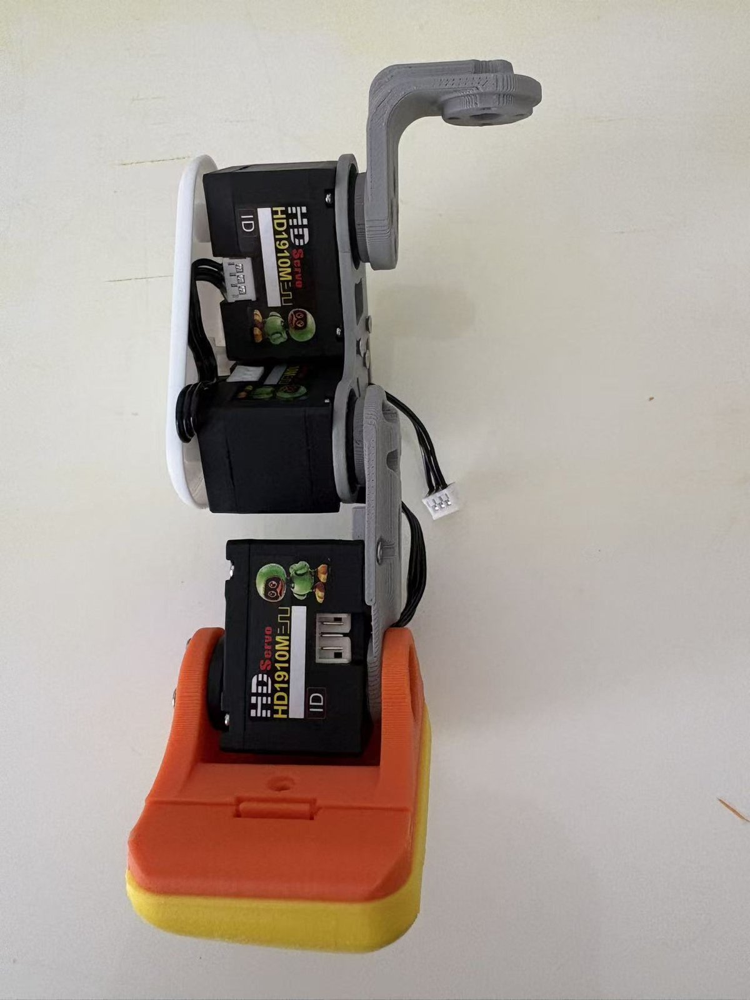
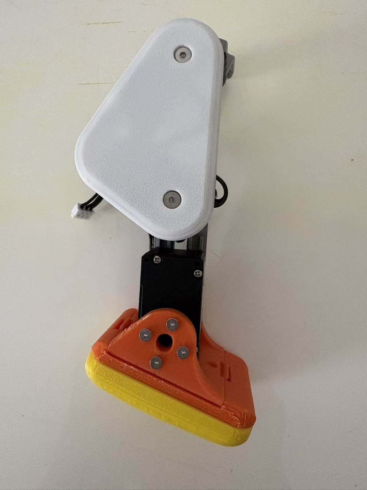
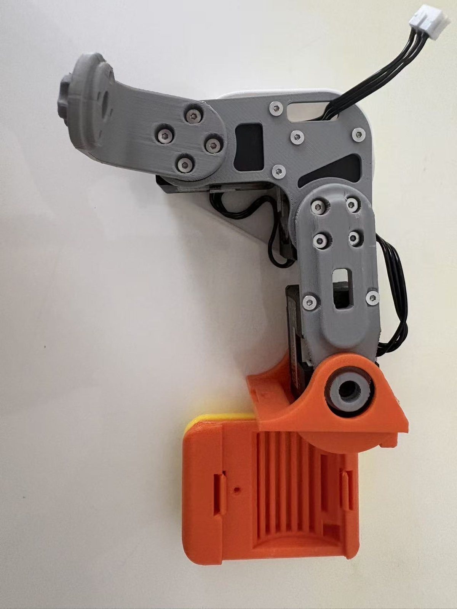
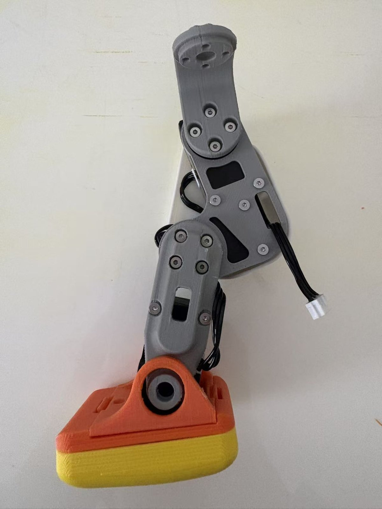
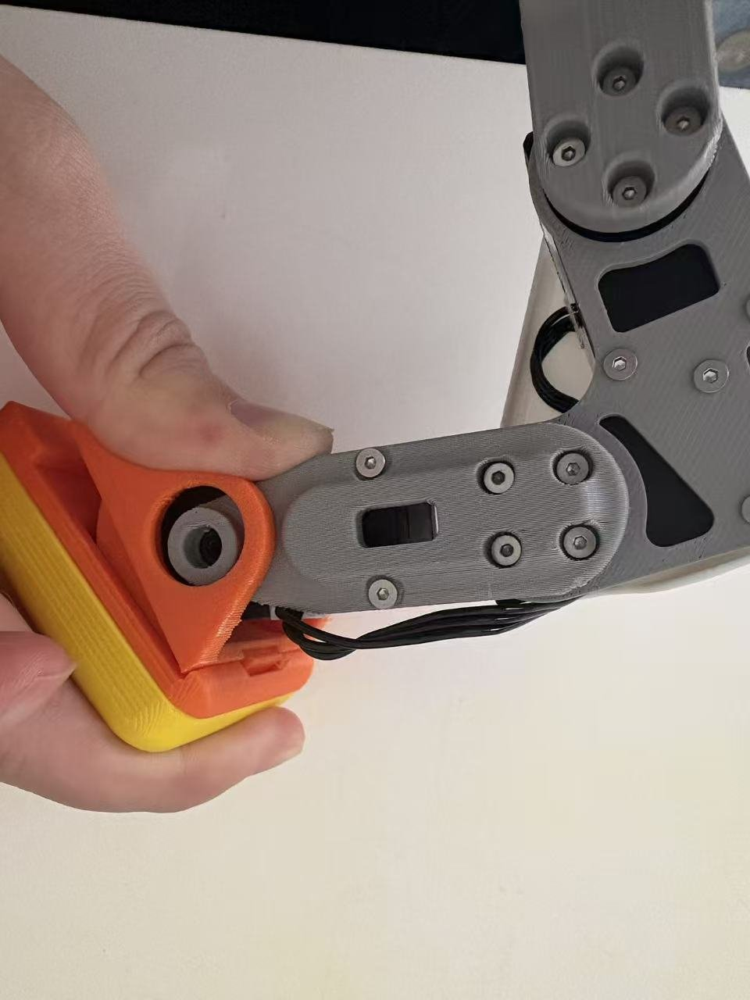
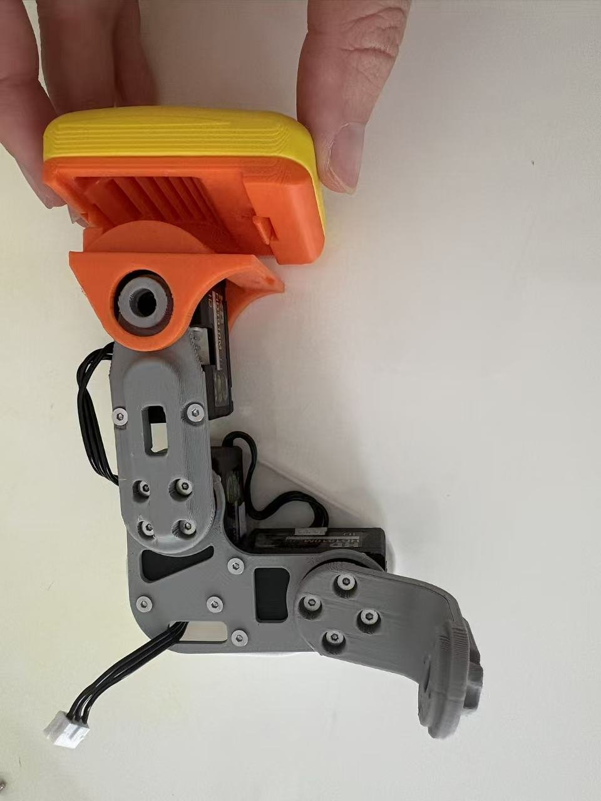

# 03 · 机械装配

> 本章面向**散件用户**：把 15 个舵机和一堆打印件拼成完整机体。成品 / 半成品套件已经装好，可直接去 [04 电子接线与舵机总线](04_电子接线与舵机总线.md)。

机械装配按"模组"来做最省心：先把腿、胯、躯干、头、脚各自装成小模块，最后合体。整个过程预计 **2–4 小时**（熟练后更快）。

---

## 0. 开装前必读的三条

**① 先编号、先校中位，再装进机体。**
15 个舵机都挂在同一条总线上、靠 ID 区分；出厂 ID 往往一样。一旦舵机被埋进腿里、壳里，再想拆出来改 ID / 校零点就很痛苦。所以**强烈建议**：装之前先按 [05 舵机调试](05_舵机调试_ID与中位校准.md) 给每个舵机写好 ID、统一波特率、并转到"中位（零点）"位置。这样装的时候每个关节都在标准零位，姿态才对得上。

ID 规划速查（详见 [11 速查](11_接口与参数速查.md)）：

```text
右腿  10 髋yaw · 11 髋roll · 12 髋pitch · 13 膝 · 14 踝
左腿  20 髋yaw · 21 髋roll · 22 髋pitch · 23 膝 · 24 踝
头颈  30 脖pitch · 31 头pitch · 32 头yaw · 33 头roll · 34 鸭嘴
```

**② 分清螺丝长度。** 四种自攻螺丝（M2×5 / M2×6 / M2×8 / M2.5×6）务必分盒。拧打印件自攻螺丝时**手感到明显阻力就停**，别大力出奇迹——打印件螺纹是"自攻"出来的，拧爆了孔就废了。

**③ 轴承要压正。** 两种轴承：**16×22×4（ET2216）用于踝等主要承重旋转处**，**10×15×3（6700K）用于较小的旋转关节**。压轴承时垫平、均匀用力，别歪着怼。

---

## 1. 舵机预处理（装配前）

1. 15 个舵机逐个连控制板，按 ID 规划写入 ID、把波特率统一到 **1 Mbps**（出厂若不是要改过来）。
2. 每个舵机转到**中位**（零点）。HD-1910 是磁编码总线舵机，中位是软件设定的参考点。
3. 建议拿记号笔 / 贴纸在每个舵机上标注它的 ID 和部位（如"L-膝 23"），装的时候不会拿错。

> 这一步做完再往下装。方法、截图、命令见 [05 舵机调试：ID 与中位校准](05_舵机调试_ID与中位校准.md)。

<p align="center"></p>

*上图：装好的单腿模组侧面，可以看到 HD1910M 舵机本体与机身上的“ID”标签位——装配前先按规划贴好每颗的 ID。*

---

## 2. 腿部模组（左右各一条）

每条腿 5 个舵机：髋 yaw → 髋 roll → 髋 pitch → 膝 → 踝，从上到下串成一条。

1. **髋部 yaw-roll 传动**：用 `yaw2roll` / `yaw_roll_motion` 等件把髋 yaw（10/20）与髋 roll（11/21）两个舵机按一体式 yaw 结构组合。注意一体式 yaw 的方向，别装反左右。
2. **大腿**：把髋 pitch（12/22）装入 `upper_leg`，贴上加强板 `upper_leg_rigidity_plate`。HD-1910 版的 `upper_leg` 已去掉定位柱，方便走线，装的时候顺手把舵机线理到预留的走线槽里。
3. **小腿与膝**：用 `leg` / `leg2` 连接膝舵机（13/23），把大腿和小腿连成可转动的膝关节。
4. **踝关节**：踝舵机（14/24）装入 `ankle`。踝处用 **16×22×4 轴承**，从外侧把轴承压入卡扣结构，再靠 `foot` 的限位卡扣锁住，降低松脱风险。
5. 把 `foot`（脚）和 TPU 打印的 `sole`（脚底）装到踝下。脚底是软的，走路防滑靠它。

<p align="center">  </p>

*上图：装配完成的单条腿模组。左—正面；中—整体（橙色脚壳 + 引出的白色 3P 舵机插头）；右—背面，可见大腿加强板与沿槽走的舵机线。注意线从每个关节的预留槽引出、留足余量。*

<p align="center"> </p>

*上图：踝关节特写。左—踝部轴承（16×22×4）从外侧压入、靠橙色脚壳卡扣锁住；右—黄色 TPU 脚底与橙色脚壳，软质脚底负责防滑和落地缓冲。*

> **装完一条腿先手动活动一下**：髋、膝、踝应各自能顺畅转到位、不打架。踝如果转不动，多半是脚底和舵机干涉或轴承压歪了——这正是 v0.1 结构把踝内部改圆弧要解决的问题。

左右两条腿镜像装配，注意 `left` / `right` 件别混。

---

## 3. 胯部与躯干

1. **胯 / yaw 固定到躯干**：把两条腿的髋 yaw 通过一体式 yaw 结构连到 `hip_l` / `hip_l1`，再固定到 `trunk_base`（躯干底座）。
2. **躯干舵机固定**：v0.1 的 `trunk_base` 给每个舵机留了**3 个固定孔**（原版只有 2 个），尽量三个孔都上螺丝，躯干才稳。注意一体式 yaw 已经给躯干前方舵机让出了拧螺丝的空间，按顺序先装里面的、再装外面的。
3. **电源 / 配重支架**：`power_support` 以舵机为基准固定。桌面调试阶段电池不上机，这里主要是结构和配重位，先按结构装好即可。
4. **主控板位**：`banana_pcb_locker` 等用于固定板卡；桌面调试阶段主控放在机体外，这步可以后置。

> 📷 *待补拍：躯干与胯部装配，每个舵机三孔固定*

---

## 4. 头与脖子

1. **脖子**：`neck` / `neck1` / `neck_pitch` 组合脖 pitch（30）与头部三轴（头 pitch 31 / yaw 32 / roll 33）。v0.1 已加厚脖子连接件，装的时候仍轻拿轻放。
2. **头壳**：`top_head_shell` / `bottom_head_shell` 合拢。注意 HD-1910 背面凸起处对应的螺丝柱已做切角避让——如果某颗螺丝拧不进，先看是不是用错了件或螺丝长度。
3. **面部**：`face_part` / `noenoeil`（眼部）等外观件最后装，先确保内部结构和线都到位。
4. 头内结构固定多用 **M2.5×6** 螺丝。

> 📷 *待补拍：头颈模组装配*

---

## 5. 下巴与鸭嘴（第 15 轴）

鸭嘴舵机（34）驱动下巴开合，是机器鸭"会说话 / 口型"的关键，但**不参与走路策略**。

1. 把鸭嘴舵机装到下巴机构，连接 `jaw` / `jaw_soft` / `soft_mouth_top`。
2. **重点**：`jaw_soft` 若与 `bottom_head_shell` 摩擦，会导致开嘴困难甚至开不了嘴。v0.1 已把 `jaw_soft` 缩短；如果你自己打印的件偏紧，可轻微打磨接触面，直到开合顺畅。
3. 装好后手动（或上电点动）试开合几次，确认全程不卡。

> 📷 *待补拍：下巴与鸭嘴机构，确认开合顺畅*

---

## 6. 外壳合拢与走线

1. **先走线、后合壳**。15 根舵机线最终要汇成一条菊花链（见 [04 接线](04_电子接线与舵机总线.md)）。合壳前把线理顺、留足长度、从预留槽引出，避免外壳压线或拉扯过紧。
2. 左右外壳 `left_shell` / `right_shell` 合拢，橙 / 白外观件最后扣上。
3. 合壳过程中反复确认：没有线被壳边夹住、没有关节被壳干涉卡死。

> 📷 *待补拍：合壳前先理好线束；外壳合拢完成*

---

## 7. 机械装配验收

全部装完，上电前先做机械自检：

- [ ] 15 个关节都能手动顺畅转到位，无卡死、无异响
- [ ] 两脚能平稳着地，脚底 TPU 贴合
- [ ] 鸭嘴开合顺畅
- [ ] 所有舵机三 / 两孔按设计固定牢靠，无松动
- [ ] 轴承无松脱、无偏心
- [ ] 线束理顺、未被外壳夹住，接口都能够到

机械没问题了，就进入电子部分 → [04 电子接线与舵机总线](04_电子接线与舵机总线.md)
