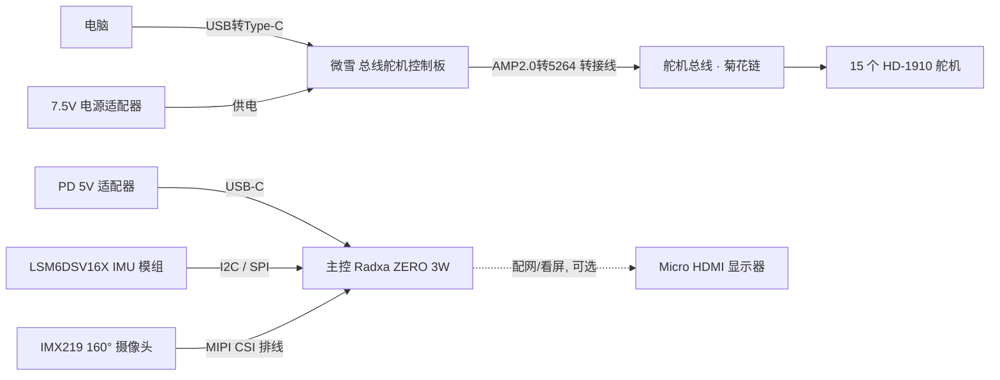

# 04 · 电子接线与舵机总线

这一章把 15 个舵机、IMU、摄像头、控制板、电源连成一个能工作的系统。**先理解结构，再动手接线**——接错了轻则扫不到舵机，重则烧板子。

> 本章按**桌面调试版**（有线）接线：主控和舵机控制板放在机体外面，适配器供电、数据线连电脑。整机集成版（电池 + HAT + 总线 IMU）等转接板就绪后另述。

---

## 1. 整体连接关系

桌面调试阶段，系统分成两条相对独立的线路：



两条线路的分工：

- **舵机线路**（控制板 + 15 舵机 + 7.5V）：先用来改 ID、校中位、点动测试（见 [05](05_舵机调试_ID与中位校准.md)）。调通后，这条总线会接到主控来跑整机控制。
- **主控线路**（主控 + IMU + 摄像头 + 5V）：主控是大脑，IMU 是内耳，摄像头是眼睛。桌面调试阶段主控单独供电、可接显示器配置。

> **桌面调试版的 IMU 接法**：你这套的 LSM6DSV16X 是现成模组，**直接挂主控的 I²C / SPI**，不在舵机总线上。（整机集成版才会把 IMU 做成挂在舵机总线上、从机 ID 200 的转接板。两者别混。）

---

## 2. 舵机总线：菊花链怎么连

15 个舵机不是各接各的，而是**串成一条链（菊花链）**：每个舵机有两个同样的接口，信号 / 电源 / 地从一个舵机进、另一个口出，接到下一个舵机。整条链只有一个入口接到控制板。

推荐的串接顺序（与标准 ID 布局对齐，便于后续软件直接套用）：

```text
控制板
  ├─ 34 鸭嘴
  └─ 33 头roll → 32 头yaw → 31 头pitch → 30 脖pitch
                                   ├─ 20 左髋yaw → 21 左髋roll → 22 左髋pitch → 23 左膝 → 24 左踝
                                   └─ 10 右髋yaw → 11 右髋roll → 12 右髋pitch → 13 右膝 → 14 右踝
```

> 分叉（头颈之后分出左右腿）靠舵机的双口实现。链路顺序不影响通信（总线靠 ID 寻址，不靠物理顺序），但**按部位顺序串接**能让线束最短、最整齐，排查也方便。

> 📷 *待补拍：舵机菊花链串接实物*

---

## 3. ⚠️ 针序：HD-1910 和"达妙 / 乐泰"方向相反

这是**最容易烧东西**的一处，务必看清。HD-1910 用的是 **AMP2.0-3P** 接口，针序是：

| 针位 | HD-1910（AMP2.0-3P） |
| --- | --- |
| 1 | **Signal（信号）** |
| 2 | **Vcc（电源）** |
| 3 | **GND（地）** |

注意：HD-1910 是 **1 = 信号、3 = 地**，这和 Dynamixel、以及部分飞特 HL 系列的 **1 = 地、3 = 信号**是**反的**。

实践要点：

- 舵机之间用**原装同款线**互串，一般不会错（两端同款口，方向天然对）。
- 舵机接到控制板那一段，用套件给的 **AMP2.0 转 5264 转接线**。接之前**务必核对转接线两端的线序**：确认舵机侧的 Signal / Vcc / GND 和控制板侧的对应脚一一对上。
- 不确定时，用万用表蜂鸣档量通断，把三根线一一对出来，再接电。**接反电源和信号可能直接烧舵机或控制板。**

> 控制板接口（微雪）一般印有丝印标注电源 / 地 / 信号；对照舵机侧针序接即可。第一次接完，先只接**一个**舵机试扫通（见 [05](05_舵机调试_ID与中位校准.md)），确认线序没问题，再串其余的。

---

## 4. 供电

| 对象 | 供电 | 说明 |
| --- | --- | --- |
| 舵机 + 控制板 | **7.5 V 电源适配器** | 7.5 V 在 HD-1910 的 4–8.4 V 范围内。由控制板的电源输入进，再经总线分给 15 个舵机 |
| 主控 | **PD 5V/2A~3A（Type-C）** | 主控单独供电，和舵机电源分开，调试时更清晰 |

供电注意：

- **先接好线、再上电**；上电前用万用表确认舵机电源正负没接反、无短路。
- 15 个舵机同在一条电源轨上。虽然不会所有舵机同时堵转，但峰值电流不小，**用套件配的适配器，别用劣质小电源**，否则一动起来就掉压、重启。
- 桌面调试阶段**不要用锂电池**——用适配器更安全、好排查。整机集成版才上可拆的 18650 电池组。

---

## 5. IMU 接线（桌面调试版）

LSM6DSV16X 模组支持 I²C 和 SPI。桌面调试版直接挂主控：

- **I²C 接法**（常用）：模组的 `VCC / GND / SDA / SCL` 四根线接到主控 40-pin 的 3.3V、GND、以及一组 I²C（如 I²C3 的 SDA/SCL）。注意 IMU 供电是 **3.3V，别接 5V**。
- 接好后在主控上用 `i2cdetect` 能扫到模组地址，说明通了（见 [08 主控刷机](08_主控系统与刷机.md)）。

> IMU 提供陀螺仪（角速度）和重力方向，是平衡控制环最核心的输入之一。模组装到躯干 `trunk_base` 预留的陀螺仪孔位（v0.1 已改为兼容 LSM6DSX 系列）。

---

## 6. 摄像头接线

- IMX219（160° 广角）通过 **MIPI CSI FPC 排线**接到主控的 22-pin CSI 口。
- **排线方向有讲究**：金手指一面朝向连接器触点，插到底、扣紧卡扣。插反了会识别不到、甚至发热。
- 摄像头**不参与走路**；它用于后续视觉功能。桌面调试阶段可以先不接，等软件阶段再装。

---

## 7. 接线完成后的检查

上电前最后过一遍：

- [ ] 舵机菊花链全部串好，入口经 AMP2.0 转 5264 接到控制板
- [ ] 转接线线序核对无误（Signal / Vcc / GND 对得上，特别是 1 = 信号这一点）
- [ ] 舵机电源来自 7.5V 适配器，正负无接反、无短路（万用表量过）
- [ ] 主控用独立 5V PD 供电
- [ ] IMU 走 3.3V I²C，未误接 5V
- [ ] 摄像头 FPC 金手指方向正确、卡扣扣紧（如已接）
- [ ] 没有裸露铜丝互相搭接

检查无误，进入 [05 舵机调试：ID 与中位校准](05_舵机调试_ID与中位校准.md)。
