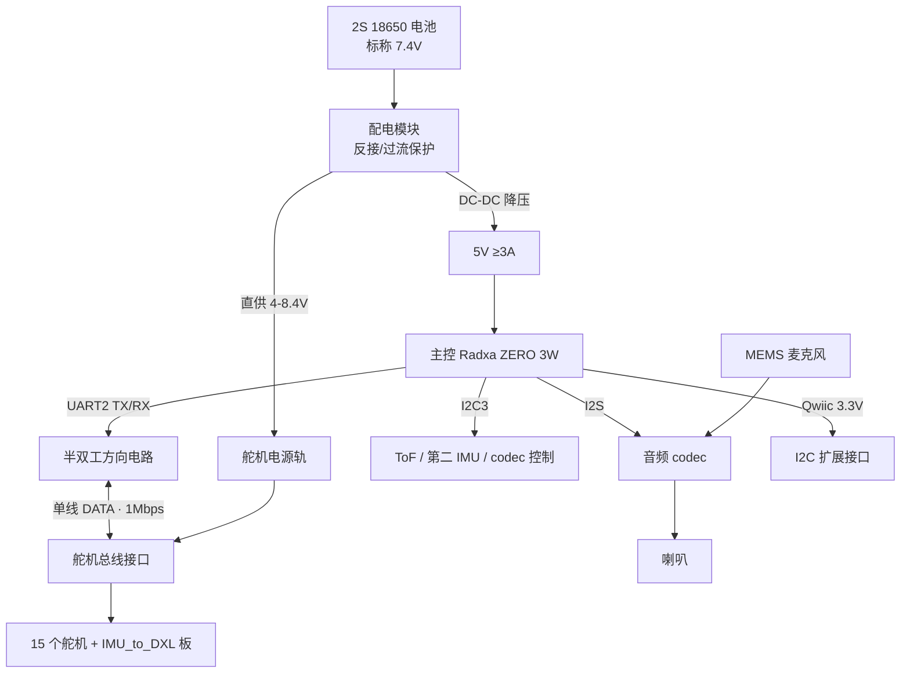
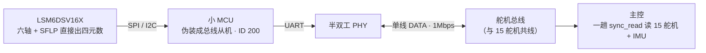

# 07 · 整机电路与自制板设计（HAT 板 / IMU_to_DXL 板）

> 本章是**电路部分的进阶**，面向想从"桌面调试版"走到"整机集成版"的用户——也就是把外置的舵机控制板、IMU、供电统统收进机体。核心是两块自制 PCB：**Zero Robot HAT 转接板** 和 **IMU_to_DXL（IMU 转舵机总线）板**。
>
> 桌面调试阶段用不到本章；你用现成的微雪控制板 + LSM6DSV16X 模组就够了（见 [04 电子接线](04_电子接线与舵机总线.md)）。等你要做"能塞进鸭子、靠电池离线跑"的整机时，再回来看这章。

本章偏设计思路与打板流程，不是给一份可直接下单的 Gerber。强烈建议**以官方开源 HAT 为第一版参考**，再按国产件和 HD-1910 改。

---

## 1. 为什么整机要自己做板

桌面调试阶段，主控、舵机控制板、IMU、电源是分开摆在桌上的，用适配器供电、杜邦线乱飞也没关系。但整机要满足三件事，现成模组做不到：

1. **体积**：外置的 URT2 / 微雪驱动板 + 独立 IMU 模组塞不进 25cm 的鸭子。
2. **一条总线搞定一切**：整机要对齐官方 50Hz 的"一趟 `sync_read` 读完 15 个舵机 + IMU"。这要求 IMU 也挂在舵机总线上、作为一个从机被同一趟读到——所以需要 IMU_to_DXL 板。
3. **配电**：电池 → 舵机轨 + 主控 5V，要有像样的配电、保护、连接器，不能靠适配器。

这三件事就是 **HAT 板**（配电 + 半双工总线 + I²C/I²S 外设）和 **IMU_to_DXL 板**（把 IMU 变成总线上的一个从机）要解决的。

---

## 2. 先参考官方开源 HAT

Pollen Robotics 开源了一块通用机器人 HAT：**[elec_RPI_Robot_HAT](https://github.com/pollen-robotics/elec_RPI_Robot_HAT)**（KiCad 9 工程，含原理图 / PCB）。它就是为这类小型足式机器人设计的，拿来做第一版参考最省事。它的关键特性：

| 功能 | 官方 HAT 的做法 | 对我们的意义 |
| --- | --- | --- |
| 电源输入 | 约 **5–28V**，以"电机电源接口"作为板子总输入 | 覆盖 2S（7.4V）锂电；给舵机轨和主控 5V 做 DC-DC |
| 舵机总线 | 支持 **Dynamixel / 飞特**，TTL 与 RS-485 都做了（线序需适配） | HD-1910 是飞特 TTL 半双工，**针序和 Dynamixel 相反**，线序必须改 |
| IMU | 板载 IMU，走 **I²C** | 官方 HAT 自带一颗（辅助），整机平衡用的主 IMU 走总线（见 §4） |
| 音频 | 集成 MEMS 麦克风；Wago 端子接外部喇叭和第二麦克风 | 实现"会叫 / 口型"所需的声音输出输入 |
| 扩展 | **Qwiic 接口**（1mm 间距，3.3V） | 接 ToF、第二 IMU 等 I²C 外设 |

> **直接拿官方 HAT 的注意点**：它按 Dynamixel/树莓派设计。你要改的主要是 ① 舵机接口线序（HD-1910 的 AMP2.0 是 1=信号/3=地，和 Dynamixel 相反）；② 把主控针脚映射对到你用的 Radxa ZERO 3W；③ 电池按 2S 18650 组重核配电。

---

## 3. HAT 板自己设计时要画的四块

如果你要从头画一版（或大改官方版），把它拆成四个功能块来设计。整体结构如下：

下面逐块说明。

### 3.1 半双工总线驱动（方向电路）

- 舵机走的是**单线半双工 TTL**：发和收共用一根 DATA 线。主控的 UART 有独立 TX/RX，中间要一个电路把"TX→单线、单线→RX"切换过来。
- 两种常见做法：
  - **自动方向**：用三态缓冲 + 简单逻辑，靠数据本身触发收发切换（官方运行时里没有方向 GPIO，说明用的是硬件自动换向）。
  - **GPIO 方向控制**：用一根 GPIO 控制 74xx245 一类收发器的方向。实现简单，但软件要在每次发完数据后精确切回接收，时序要紧。
- 新手建议直接复用官方 HAT 的这部分电路（已验证能驱动飞特 / Dynamixel）。
- 波特率 1Mbps、每拍要读 15+1 个设备，**信号完整性**要注意：总线不要拉太长、分叉点做好、必要时加端接。

### 3.2 配电

- 输入：2S 锂电（标称 7.4V，满电 8.4V）。HD-1910 工作电压 4–8.4V，可以**直接用 2S 给舵机轨供电**（省掉一级 DC-DC），但要核对舵机过压阈值（HD-1910 规格过压阈约 10V，2S 满电 8.4V 有余量）。
- 主控要 **5V**：用一颗 DC-DC（降压）从电池降到 5V/≥3A 给 Radxa。
- 舵机轨要扛**峰值电流**：15 颗舵机虽不会同时堵转，但峰值不小。MOSFET / 铜箔 / 连接器都按足够的电流余量设计（参考单颗堵转约 1.6A @6V，留总线余量）。
- 加基本保护：反接保护、过流 / 保险、必要的电容滤波。

### 3.3 I²C / I²S 外设

- **I²C**：接 ToF（8×8 多区测距，如 VL53L5CX）、第二 IMU、codec 控制等。注意 Radxa 的 I²C3 在 40-pin 的 3/5 脚，原厂这个控制器的另一路给了 USB-C PD——官方 overlay 把它改到 M0 后会**失去 PD 协商**（普通 5V 充电仍可用），这点在设计供电时要知道。
- **I²S**：接音频 codec（官方用 TLV320AIC3104），再出到喇叭。实现"叫声 / 口型"。
- **麦克风**：MEMS 麦克风（板载）+ 可选外接第二麦克风。

### 3.4 主控接口

- 按你的主控（Radxa ZERO 3W）引出：**UART2**（舵机总线）、**I²C3**、**I²S**、**CSI**（摄像头，一般直接走主控的 22-pin CSI，不一定经 HAT）、3.3V / 5V / GND。
- **务必 mask 掉 UART2 的 `serial-getty`**，否则系统登录终端会占死舵机总线（见 [08 刷机](08_主控系统与刷机.md)）。

---

## 4. IMU_to_DXL 板：让 IMU 变成总线上的一个从机

这是整机集成版最有特色的一块小板。目的：**让 IMU 和 15 个舵机挂在同一条总线上，被主控的同一趟 `sync_read` 一起读到**，而不是在主控上单独走 I²C（那样会多一条异步路径，难对齐 50Hz 节拍）。

> 数据块：从寄存器 **124** 起 **12 字节** = 陀螺 x/y/z（`int16`）+ SFLP 四元数 x/y/z（半精度 `fp16`）；`w` 由主机补算。**融合在板上做**，主机直接拿四元数，不自己算。

### 4.1 组成

| 部分 | 作用 |
| --- | --- |
| **IMU 芯片** | LSM6DSV16X（六轴 + 板载 SFLP 传感器融合，直接出四元数） |
| **一颗 MCU** | 读 IMU，把数据按舵机协议"伪装"成一个总线从机 |
| **半双工 PHY** | 把 MCU 的 UART 接到单线总线，和舵机共用一条 DATA |

### 4.2 行为对齐（关键参数）

要让主控把它当成"第 16 个设备"来读，必须对齐官方约定：

- **从机 ID：200**
- **波特率：1 Mbps**（和舵机总线一致）
- **数据块**：从寄存器 **124** 起，**12 字节**：

| 偏移 | 内容 |
| --- | --- |
| 0–5 | 陀螺仪 x/y/z，`int16` 小端，量程 ±500 dps |
| 6–11 | SFLP 四元数 x/y/z，IEEE binary16（半精度）；`w` 由主机用 `√(1−x²−y²−z²)` 补 |

> 这样主控一趟 `sync_read` 把 15 个舵机的位置/速度/电流和 IMU 的陀螺/四元数一起读回，**融合不在主机做**——IMU 板自己用 SFLP 出好四元数，主机直接拿来用。这是能稳定跑 50Hz 的关键设计。

### 4.3 自己做的难点

- 上游官方的 `imu_to_dxl` **原理图未开源**（全网零命中）。不过社区已经做出一版完整的逆向复刻——原理图、PCB、STM32 固件、焊接用交互式 BOM 全部公开，见 [microduck-replica 的 `hardware/imu_to_dxl/`](https://github.com/fanhao375/microduck-replica/tree/master/hardware/imu_to_dxl)。⚠️ 那是**第三方复刻、未经量产验证**，可作参考起点而非直接投产。
- MCU 固件要实现飞特/Dynamixel 从机协议（响应 `sync_read`、按 ID 200 应答），裸板需用 **SWD** 烧录；没刷固件总线上就扫不到 ID 200。这是整块板最花时间的部分。
- 可以先用桌面调试版（IMU 直接挂主控 I²C）把平衡环跑通，再把 IMU_to_DXL 作为整机优化项。
- 板子到手后**怎么挂到总线上**（串在链上哪个位置、电流要注意什么），见 [12 整机接线：电源与 IMU](12_整机接线_电源与IMU.md#2-imu_to_dxl-板怎么接)。

---

## 5. 打板（PCB 制造）流程

无论是改官方 HAT 还是自制小板，打样流程大同小异：

1. **用 KiCad 打开 / 绘制**（官方 HAT 是 KiCad 9 工程）。画原理图 → 布局 → 布线 → DRC 检查。
2. **导出 Gerber + 钻孔文件 + BOM + 贴片坐标（CPL）**。
3. **下单打样**：国内常用 **嘉立创（JLCPCB）/ 立创商城**，支持 PCB + SMT 贴片一条龙；也可华强等。
   - 打样参数：一般 2 层板、1.6mm 厚、1oz 铜（大电流处考虑 2oz）、喷锡或沉金。
   - 贴片：把 BOM 里的元件尽量选平台常备库，省贴片费和缺料风险。
4. **回板后自检**：先不装元件/不上电，万用表量电源对地有没有短路；再上电量各路电压（舵机轨、5V、3.3V）对不对，最后才接主控和舵机。
5. **小批量验证**：先做 1–2 块验证功能，确认没问题再批量。

> 📷 *待补拍：HAT 转接板打样实物*

> **给卖家 / 量产的建议**：整机集成版的两块板是你的核心竞争力，也是最容易出问题的地方。先把官方 HAT 改稳、小批量跑通，再谈量产；把每版的 Gerber、BOM、改动点记录清楚，方便迭代和售后。

---

## 6. 整机集成版的接线差异（相对桌面调试版）

| 项目 | 桌面调试版 | 整机集成版 |
| --- | --- | --- |
| 舵机总线入口 | 外置微雪控制板（Type-C 连 PC） | **HAT 板**（主控 UART2 → 半双工 → 总线） |
| IMU | LSM6DSV16X 模组挂主控 I²C | **IMU_to_DXL 板**，串在舵机链中（31 头pitch 与 20 左髋yaw 之间），从机 ID 200 |
| 供电 | 7.5V 适配器 + 5V PD | **NP-F550（2S，6.6–8.4V）** → HAT 配电 → 舵机轨 + 主控 5V |
| 显示 | 可接 Micro HDMI | 不接，纯远程 |
| 转接线 | AMP2.0 转 5264 | HAT 上直接预留舵机口，不再需要这根 |

> 具体到**哪根线接哪个口、① 脚在板子哪一头、上电顺序**，见 [12 整机接线：电源与 IMU](12_整机接线_电源与IMU.md)。

---

## 7. 推进建议

1. 先用桌面调试版（[04](04_电子接线与舵机总线.md) + [05](05_舵机调试_ID与中位校准.md) + [06](06_通电自检与联调.md)）把控制、校准、IMU 读数全跑通。
2. 拿官方 [elec_RPI_Robot_HAT](https://github.com/pollen-robotics/elec_RPI_Robot_HAT) 改线序 + 主控针脚 + 电池配电，打第一版 HAT。
3. IMU_to_DXL 作为进一步优化，先跑通固件（ID 200 从机 + SFLP 四元数），再并入总线。
4. 软件侧刷机与跑策略见 [08 主控系统与刷机](08_主控系统与刷机.md) 和 [09 仿真、步态与强化学习](09_仿真步态与强化学习.md)。

> 参考资料：官方 HAT [elec_RPI_Robot_HAT](https://github.com/pollen-robotics/elec_RPI_Robot_HAT)；社区对 MicroDuck 电控的逆向整理（如 [microduck-replica](https://github.com/fanhao375/microduck-replica)）可作交叉参考——注意这些都是社区还原，非官方量产 BOM。
