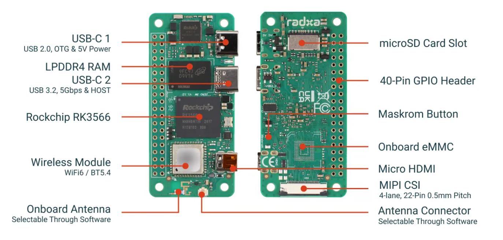

# 08 · 主控系统与刷机（Radxa RK3566）

> 本章是**软件部分的起点**：把主控（瑞莎 Radxa ZERO 3W，RK3566）的系统刷好、配好，并在主控上把舵机总线和 IMU 读通。做完这章，你就有了一台能跑控制程序的"大脑"。

主控选的是 **Radxa ZERO 3W**：RK3566、四核 A55、板载 Wi-Fi 6 / 蓝牙、40-pin、MIPI CSI，和官方开发栈差异最小。优先买 **≥1GB RAM、有 eMMC** 的那档（官方机是 1GB + 32GB eMMC）。

---

## 0. 先认识一下这块板

<p align="center"></p>

*上图：Radxa ZERO 3W 正面（左）与背面（右）。官方完整说明见 [Radxa ZERO 3 硬件接口文档](https://docs.radxa.com/zero/zero3/hardware-design/hardware-interface)。*

| 接口 | 位置 | 在机器鸭里干什么 |
| --- | --- | --- |
| **USB-C 1**（USB 2.0 OTG + 5V 供电） | 正面靠上 | **唯一的供电口**，只接受 5V（官方建议 ≥ 5V/2A）；刷机也走这个口 |
| **USB-C 2**（USB 3.2 Host） | 正面中部 | 接外设，例如桌面调试版的 USB 串口舵机驱动板（可能要 C 转 A 头）。**不能给板子供电** |
| **40 针 GPIO** | 侧边双排 | 插 HAT 板；桌面调试时 IMU 走这里的 I²C，舵机总线走这里的 UART |
| microSD 卡槽 | 背面靠上 | 装系统的 TF 卡 |
| 板载 eMMC | 背面中部 | 有 eMMC 的型号可把系统刷进去，比 TF 卡快、稳 |
| **Maskrom 按键** | 背面 | 刷 eMMC 时按住它再上电，进入 maskrom 模式（见 §1.5） |
| Micro HDMI | 正面靠下 | 首次配置时接显示器 |
| MIPI CSI（22 针，0.5 mm 间距） | 背面下沿 | 接 IMX219 摄像头 |
| Wi-Fi 6 / BT 5.4 | 正面靠下 | 配网、蓝牙。板载天线和外置天线座可软件切换——装进机壳后信号差，就换外置天线 |

> ⚠️ **40 针的 8 / 10 脚（UART2_M0）默认是调试串口。** 按 Radxa 官方文档：这组 UART 出厂是 U-Boot 的调试控制台，波特率 **1500000**、8N1；把它改作普通串口后，**开机阶段这根线上若有输入，可能打断启动**。它恰好就是舵机总线要用的那组 UART。舵机和 IMU_to_DXL 都是"问了才答"的从机，开机时总线一般是安静的，通常不会触发；但如果遇到主控**偶发卡在开机阶段**，先排查这一条（比如先让主控启动完成，再接通舵机总线）。系统起来后的另一处占用（`serial-getty`）见 §3.1。

---

## 1. 刷机：把系统写进卡

### 1.1 准备

- 64GB TF 卡（A2）+ 读卡器
- 一根 Type-C 数据线 + 5V 电源（Radxa **只支持 5V 供电**，用 PD 头也要确保输出 5V）
- 可选：Micro HDMI 线 + 显示器 + 键鼠（首次配置方便）

### 1.2 下载镜像

去 Radxa 官方下载页拿对应 ZERO 3W 的镜像：**[Radxa ZERO 3 资源下载](https://docs.radxa.com/en/zero/zero3/download)**。常见两类：

- **官方 Debian/Ubuntu 镜像**（Radxa 维护，开箱即用、驱动最全）
- **Armbian 镜像**（社区维护，和官方 MicroDuck 运行时同一路线；官方运行时设备树写死 `compatible = "radxa,zero-3w"`）

> 入门建议先用**官方 Debian 镜像**跑通，熟悉后再按需要换 Armbian。注意区分"带桌面(desktop)"和"精简(CLI)"版本——机器人用精简版即可，省资源。

### 1.3 写卡（balenaEtcher）

1. 下载安装 [balenaEtcher](https://etcher.balena.io/)（Windows / macOS / Linux 都有）。
2. **先解压镜像**（`.img.xz` / `.7z` 要先解压成 `.img`，Etcher 不吃压缩包）。
3. Etcher 里 **Flash from file** 选镜像 → **Select target** 选 TF 卡（**看准盘符，别选错把硬盘刷了**）→ **Flash!**。
4. 等到 **Flash Complete!**。

> Linux / macOS 命令行党也可以用 `dd`：`sudo dd if=xxx.img of=/dev/sdX bs=4M status=progress conv=fsync`（`/dev/sdX` 换成你的卡，**务必确认设备号**）。

### 1.4 首次启动

1. 卡插进主控的 microSD 槽。
2. Type-C（OTG 口）接 5V 供电。
3. 接了 HDMI 的话会看到桌面 / 登录界面。
4. **默认账号密码：`radxa` / `radxa`**（首次登录建议马上改密码）。

### 1.5 （可选）刷到 eMMC

有 eMMC 的板子可以把系统装到 eMMC（更快更稳）：进入 **maskrom 模式**，用瑞芯微的 `rkdeveloptool`（或官方工具）把镜像写进 eMMC。步骤按官方 [Install OS on eMMC](https://docs.radxa.com/en/zero/zero3/getting-started/install-os) 指南做。新手先用 TF 卡跑通，不急着上 eMMC。

---

## 2. 配网与基础环境

接了屏用桌面配网最简单；没屏就用串口 / SSH。

**连 Wi-Fi（命令行）**：

```bash
# 列出网络
nmcli dev wifi list
# 连接
sudo nmcli dev wifi connect "你的WiFi名" password "你的密码"
# 查看 IP
ip addr
```

**更新系统 + 装常用工具**：

```bash
sudo apt update && sudo apt upgrade -y
sudo apt install -y i2c-tools python3-pip git build-essential
```

之后就能用 SSH 远程登录主控（`ssh radxa@<主控IP>`），不必一直接屏。

---

## 3. 打开并让出外设（关键三步）

这三步不做，后面舵机总线、IMU、NPU 都用不了。

### 3.1 ⚠️ 释放 UART2（舵机总线）

系统默认在 UART2 上开了一个**登录终端**（`serial-getty`），它会**占死整条舵机总线**，导致在主控上一个舵机都扫不到。必须关掉：

```bash
# 关闭并屏蔽 UART2 上的 getty（具体设备名以你的系统为准，常见 ttyS2）
sudo systemctl stop serial-getty@ttyS2.service
sudo systemctl disable serial-getty@ttyS2.service
sudo systemctl mask serial-getty@ttyS2.service
```

> 这里关掉的是**系统启动之后**的登录终端。这组 UART 在**开机阶段**还是 U-Boot 的调试控制台（1500000 波特率），见 §0 的提示。

### 3.2 使能 UART / I²C 等接口（overlay）

Radxa 用设备树 overlay 打开 40-pin 上的 UART2、I²C3 等。编辑 `/boot/` 下的配置（官方镜像常见 `/boot/uEnv.txt` 或 `rsetup` 工具里的 Overlays 选项）：

```bash
# 官方镜像可用 rsetup 图形化配置 overlay（Overlays → 勾选 uart2 / i2c3）
sudo rsetup
```

打开后 **重启** 生效。重启后检查：

```bash
ls /dev/ttyS2       # 舵机 UART 应存在
ls /dev/i2c-*       # I²C 总线应存在
```

### 3.3 （视觉才需要）打开 NPU

RK3566 的 NPU 出厂在设备树里是 **disabled**。走路用不到 NPU，只有视觉检测才需要。要用时按官方脚本写 overlay 并**重启**绑定。走路阶段可以先不管它。

---

## 4. 在主控上把总线和 IMU 读通

这是硬件和软件的接合点——把 [06 通电联调](06_通电自检与联调.md) 里用控制板做的事，搬到主控上做一遍。

### 4.1 扫舵机总线（1 Mbps）

把舵机总线接到主控的 UART2（整机版经 HAT；桌面版也可以把微雪板的总线接过来），用脚本在 1Mbps 下扫描，期望扫到 **15 个 ID**（10–14 / 20–24 / 30–34）。

- 可以用飞特 / Dynamixel 的 Python 库（如 `feetech-servo-sdk` / `dynamixel_sdk`，或上游用的 `rustypot`）写几行扫描脚本：打开 `/dev/ttyS2` @ 1000000，ping 每个 ID。
- 扫不全 → 回 [08 FAQ 思路]：线序、波特率、getty 没关、ID 冲突（见 [10 FAQ](10_常见问题FAQ.md)）。

### 4.2 读 IMU

桌面调试版的 LSM6DSV16X 挂在主控 I²C 上：

```bash
# 扫 I²C 总线，看到 IMU 地址（LSM6DSV16X 常见 0x6A/0x6B）说明通了
sudo i2cdetect -y 3     # 3 换成你使能的 I²C 总线号
```

能扫到地址后，用对应驱动 / Python 库读陀螺仪和加速度；轻轻转动机体，数值应随之变化。整机集成版则改为从舵机总线上按 ID 200 读 IMU（见 [07 §4](07_整机电路与自制板设计.md)）。

---

## 5. 板载控制程序（运行时）

让鸭子"动起来"的板载程序，上游是一套守护进程 + 命令行工具，核心是 **`robotd`**（来自 Pollen 的 [microduck](https://github.com/pollen-robotics/microduck)，Apache-2.0）：

- `robotd` 独占舵机总线和机身 IMU，跑安全层和 **50Hz 控制环**，是**唯一能写电机**的进程。
- 其它进程分管配网/蓝牙、更新、手柄、摄像头麦克风、ToF。
- 进程间用本地 socket 上的 JSON-RPC；控制面走 socket，视频/音频帧不走 socket。

入门不必一上来铺开全部进程。**先把最小闭环跑通**：
`读 15 个舵机状态 + 读 IMU → 组成观测 → （先用简单动作或策略）→ 写回目标角度`，频率先低一点、增益先小一点、腿先悬空测。

> 另一条更轻的参考路线：Open Duck Mini 的板载运行时 [Open_Duck_Mini_Runtime](https://github.com/apirrone/Open_Duck_Mini_Runtime)（跑在 Pi Zero 2W 上），代码更精简，适合理解"读状态→跑 ONNX→发指令"这条主干。

---

## 6. 本章验收

- [ ] 系统刷好、能登录、能联网、能 SSH
- [ ] UART2 的 getty 已 mask，`/dev/ttyS2` 存在
- [ ] I²C 已使能，`i2cdetect` 能看到 IMU 地址
- [ ] 主控上 1Mbps 能扫到 15 个舵机
- [ ] 能读到 IMU 陀螺仪/加速度，随姿态变化

搞定后，就可以进入最有意思的部分——让它学会走路 → [09 仿真、步态与强化学习](09_仿真步态与强化学习.md)

---

## 参考来源

- Radxa ZERO 3 硬件接口说明（接口、供电、调试串口）：https://docs.radxa.com/zero/zero3/hardware-design/hardware-interface
- Radxa ZERO 3 安装系统 / 下载：https://docs.radxa.com/en/zero/zero3/getting-started/install-os · https://docs.radxa.com/en/zero/zero3/download
- 上游运行时 microduck（Pollen，Apache-2.0）：https://github.com/pollen-robotics/microduck
- Open Duck Mini 板载运行时：https://github.com/apirrone/Open_Duck_Mini_Runtime
- 主控选型详解（为何 RK3566、平替）：https://github.com/JoyandAI/OpenMicroDuck/blob/main/docs/main_controller.md
