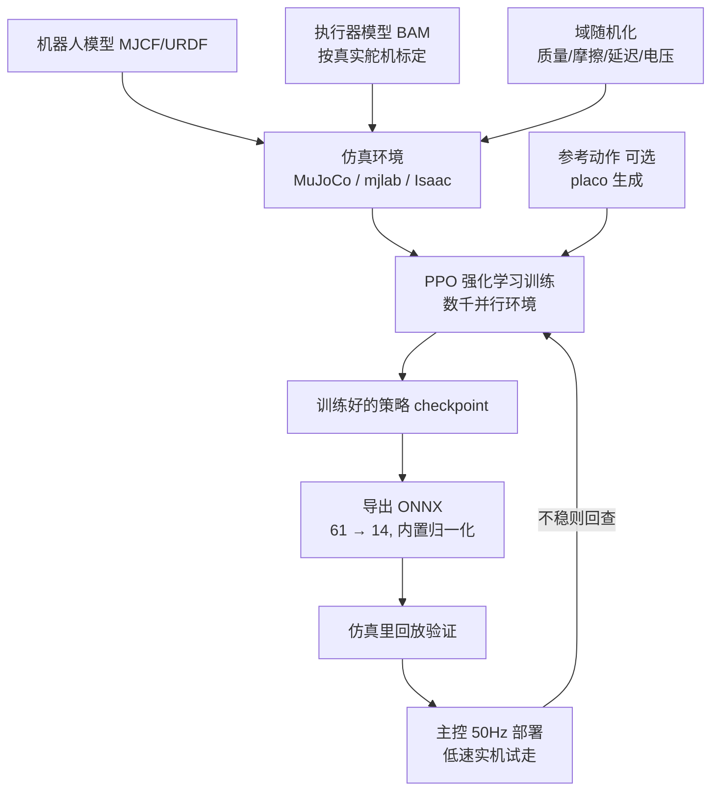

# 09 · 仿真、步态与强化学习

> 这是让机器鸭"自己站稳、会走"的部分。它不是写死的舞蹈动作，而是用**强化学习（RL）在仿真里训练出一个神经网络策略**，导出成 ONNX，放到主控上以 50Hz 执行。本章讲清整条链路、给出可操作的工具和命令入口。

**一句话**：在电脑/服务器的物理仿真里让成千上万只虚拟鸭子反复试错、学会走路 → 把学到的策略导出成一个小模型（ONNX）→ 放到真鸭子主控上每 20ms 跑一次。

---

## 1. 为什么是"训练"而不是"编程"

双足走路是强耦合、易摔倒的动态平衡问题，手写规则很难覆盖所有扰动。强化学习的思路是：给机器人一个"奖励"（比如"按指令速度前进、别摔、省力"），让它在仿真里自己摸索出能拿高分的动作。训练出来的，是一个把**传感器观测 → 关节目标**的函数（神经网络）。

**核心契约（换舵机也不能变）**：

| 项 | 值 |
| --- | --- |
| 控制频率 | **50 Hz**（每 20ms 决策一次） |
| 观测维度 | **61** = 陀螺(3) + 重力投影(3) + 关节位置(14) + 关节速度(14) + 上一动作(14) + 指令(13) |
| 动作维度 | **14**（14 个走路关节；鸭嘴第 15 轴不进策略） |
| 指令(13) | 速度 `vx,vy,vyaw`(3) + 头部目标(4) + 身体姿态(6) |
| 策略格式 | **ONNX**，主控 CPU 上用 ONNX Runtime 跑 |

> **⚠️ 换了舵机就必须重训。** 官方策略是按 Dynamixel XL330 舵机训练的；你的鸭子用 HD-1910，质量分布和执行器特性不同，**官方 ONNX 直接上多半站不稳**。要用适配 HD-1910 的参数重训。

---

## 2. 整条流水线

下面逐段说。

---

## 3. 仿真环境：在哪训

机器鸭的 RL 生态有两条主流路线，都可用：

### 路线 A：MuJoCo / mjlab（MicroDuck 官方路线）

- 官方训练仓 [microduck_rl](https://github.com/pollen-robotics/microduck_rl) 用 **mjlab**（基于 **MuJoCo Warp**，GPU 加速），一次并行跑 **约 4096 只**虚拟鸭子，用 **PPO** 训练。
- 适配 HD-1910 的 fork：**[JoyandAI/microduck_rl](https://github.com/JoyandAI/microduck_rl)** 的 `develop` 分支，已经把飞特 HD-1910 的执行器（BAM）参数放进 `vendor/bam/bam/params/hd1910`。
- 需要 CUDA（NVIDIA GPU）；没有本地 GPU 可以用 **Hugging Face Jobs**（`--hf-jobs`）跑云端训练。

### 路线 B：MuJoCo Playground（Open Duck 路线）

- 同生态的 Open Duck 项目用 **[Open_Duck_Playground](https://github.com/apirrone/Open_Duck_Playground)**（基于 MuJoCo Playground 的 RL 环境）。
- 配套 **[参考动作生成器](https://github.com/apirrone/Open_Duck_reference_motion_generator)**：用 **placo** 先生成一段"标准走路"参考轨迹，训练时让策略模仿它，能更快学会自然步态（模仿学习 + RL）。
- Open Duck Mini v1 早期还用过 **Isaac Gym + AWD**，并用 Rhoban 的 **[BAM](https://github.com/Rhoban/bam)** 做舵机辨识。

> **怎么选**：想和 MicroDuck 主线最对齐、直接复用官方 61/14 契约和 HD-1910 参数 → 走 **路线 A（microduck_rl fork）**。想要更完整的"参考动作 + playground"教学链路、或打算在 Isaac 里折腾 → 看 **路线 B**。两者产物都是 ONNX，都能部署到同一套主控。

关于 **Isaac Sim / Isaac Lab**：NVIDIA 的机器人仿真平台，并行度高、渲染好，也能训同类步态策略。它学习曲线更陡、对显卡要求更高；本项目的现成资产主要在 MuJoCo 侧，Isaac 更适合你已经熟悉它、或要做大规模训练时再上。

---

## 4. 执行器模型（BAM）：sim-to-real 的关键缝

仿真里**最影响能否上真机**的不是画面，而是舵机建模。如果仿真里的舵机是"理想电机"，训出来的策略一到真机就垮。

- 官方用 **BAM M6** 执行器模型：按舵机的**电压控制律、反电动势、库仑/Stribeck/负载相关摩擦**建模，还包括电池电压下垂、指令延迟。
- 换成 HD-1910 后，要用 HD-1910 的 BAM 参数（上游 fork 已提供）。想更准可以自己做**舵机辨识**：用 [Rhoban/bam](https://github.com/Rhoban/bam) 的流程，让真舵机跑一组激励、拟合出摩擦/惯量等参数。
- **域随机化**：训练时随机化质心、质量惯量、关节摩擦、转子反射惯量、推力扰动、IMU 安装偏差、编码器零偏等。目标是让策略对"仿真和现实的差距"鲁棒，而不是精确拟合某一台真机。

> 直觉：**BAM 让仿真里的"假舵机"像真舵机一样有摩擦、会下垂、有延迟；域随机化让策略见过各种"不完美"**。两者合起来，策略才敢上真机。

---

## 5. 训练流程（以 microduck_rl 为例）

典型步骤（具体命令以仓库 README 为准，这里给骨架）：

1. **装环境**：克隆 [JoyandAI/microduck_rl](https://github.com/JoyandAI/microduck_rl)（`develop` 分支），按说明装 mjlab / MuJoCo Warp / 依赖（需 CUDA）。
2. **冒烟测试**：先小规模验证管线通不通，比如 64 个环境、5 次迭代，确认不报错、奖励在动。
3. **正式训练**：开到约 4096 个环境跑完整训练（项目估计约 **1–2 小时**一轮，视显卡）。没有本地 GPU 用 `--hf-jobs` 上云。
4. **回放检查**：加载某个 checkpoint，在仿真里看它走得稳不稳、自然不自然。
5. **导出 ONNX**：用仓库的 `scripts/export.py` 把推理策略导出成 ONNX，**归一化会被烘焙进模型**（手动转 checkpoint 会让策略看到未归一化输入而出错）。期望图形状 `[1,61] → [1,14]`。
6. **ONNX 离线验证**：用 `scripts/infer_policy.py` 在 CPU 版 MuJoCo 里跑导出的 ONNX，确认和训练时行为一致。

---

## 6. 部署到真机 + sim-to-real 验证顺序

导出的 ONNX 放到主控，由板载控制程序（`robotd` 或你的最小闭环）每拍跑一次。**别一步到位直接让它地上狂奔**，按下面顺序逐级验证，出问题好定位：

1. **训练健康**：奖励曲线正常、没有退化。
2. **仿真回放**：在仿真里策略走得稳。
3. **ONNX 彩排**：导出的 ONNX 在 CPU MuJoCo 里和训练行为一致。
4. **运行时验收**：主控上能以 50Hz 读状态、跑 ONNX、发指令，延迟和抖动可接受。
5. **实机低速试走**：空地、低速、**先牵着/架着**，小步验证。

> **如果仿真里稳、真机却抖/摔**：优先查这几项——舵机假设（BAM 参数对不对、波特率够不够）、时序（是不是真 50Hz）、标定（中位/编码器零偏）、观测顺序（61 维拼的顺序和训练一致吗）、接触条件（脚底摩擦、TPU）。先排查再重训，别盲目重训。

---

## 7. 先玩起来：浏览器仿真沙盒

不想先装一堆环境？官方做了网页版仿真：**[microduck-simulator](https://huggingface.co/spaces/pollen-robotics/microduck-simulator)**，用 WebAssembly + onnxruntime-web，在浏览器里以同样的 50Hz 跑真实策略。拿它先建立直观认识、验证思路，再回头搭训练环境，事半功倍。

---

## 8. 概念速查（新手友好）

| 名词 | 一句话解释 |
| --- | --- |
| **RL（强化学习）** | 让智能体通过"试错 + 奖励"自己学会一项任务 |
| **PPO** | 一种稳定常用的 RL 算法（近端策略优化），MicroDuck 用它训步态 |
| **策略（Policy）** | 把观测映射到动作的神经网络，就是最终那个 ONNX |
| **观测/动作** | 策略的输入(61)和输出(14) |
| **MuJoCo** | 一个物理仿真引擎，机器人在里面"做实验" |
| **mjlab / MuJoCo Playground** | 基于 MuJoCo 的 RL 训练环境框架 |
| **Isaac Sim / Isaac Lab** | NVIDIA 的机器人仿真/训练平台，另一种选择 |
| **BAM** | 舵机执行器模型，让仿真舵机接近真实舵机 |
| **域随机化** | 训练时随机扰动参数，让策略更鲁棒、好上真机 |
| **sim-to-real** | 把仿真学到的策略迁移到真实机器人 |
| **ONNX** | 跨框架的模型格式，主控用它跑推理 |
| **参考动作/模仿学习** | 先给一段"标准走路"示范，让策略模仿，学得更快更自然 |

---

## 9. 参考来源

| 内容 | 链接 |
| --- | --- |
| MicroDuck 官方训练仓 microduck_rl | https://github.com/pollen-robotics/microduck_rl |
| HD-1910 适配 fork（develop） | https://github.com/JoyandAI/microduck_rl |
| 官方 ONNX 策略（XL330 版，需重训参考） | https://huggingface.co/pollen-robotics/microduck-policies |
| 浏览器仿真沙盒 | https://huggingface.co/spaces/pollen-robotics/microduck-simulator |
| Open Duck Playground（MuJoCo Playground 环境） | https://github.com/apirrone/Open_Duck_Playground |
| Open Duck 参考动作生成器（placo） | https://github.com/apirrone/Open_Duck_reference_motion_generator |
| Open Duck Mini 板载运行时 | https://github.com/apirrone/Open_Duck_Mini_Runtime |
| 舵机辨识 BAM | https://github.com/Rhoban/bam |
| 科普：MicroDuck 如何学会走路（PPO + sim2real） | https://openelab.io/blogs/learn/how-microduck-learns-to-walk-mujoco-ppo-sim-to-real |

> 这些仓库仍在快速迭代，命令和脚本名可能变化，动手前先看一眼各仓库最新 README。
