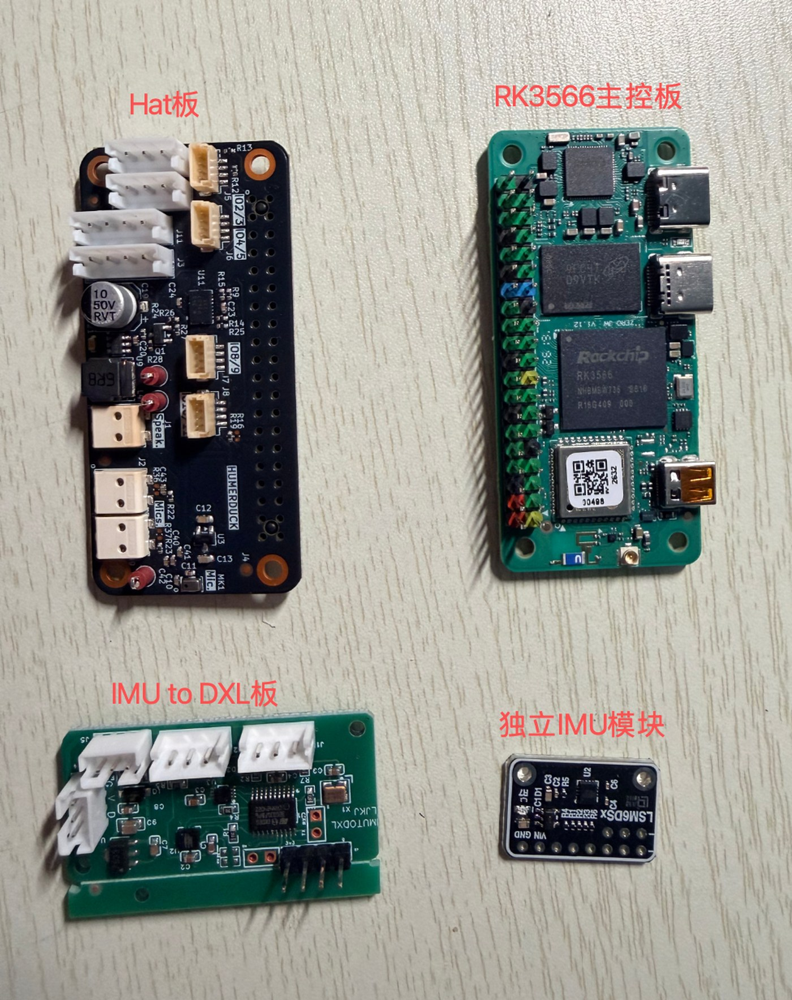
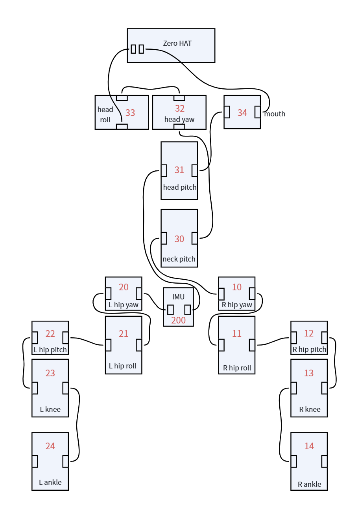
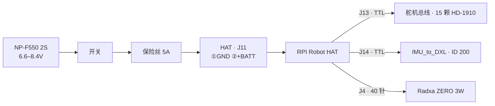

# 12 · 整机接线：HAT 供电、IMU_to_DXL、独立 IMU 模块

[04 电子接线与舵机总线](04_电子接线与舵机总线.md) 讲的是**桌面调试版**（外置控制板 + 适配器）。这一章补上**整机集成版**：电池怎么接 HAT、IMU_to_DXL 板怎么挂、以及如果你手上是独立 IMU 模组又该怎么接主控。

<p align="center"></p>
<p align="center"><sub>整机集成涉及的四块板。<b>IMU_to_DXL 板</b>和<b>独立 IMU 模组</b>是两条互斥的路线，二选一即可——见第 2、3 节。</sub></p>

### 这一章要接成什么样

<p align="center"></p>
<p align="center"><sub>整机集成版的总线拓扑。15 个舵机 + IMU_to_DXL（ID 200）全部挂在 HAT 引出的同一条半双工总线上。</sub></p>

> 图中 IMU_to_DXL 串在 `31 头pitch` 和 `20 左髋yaw` 之间，下游是左腿 5 颗（额定 2.5 A，在 3 A 门槛内，可用）。**但如果 HAT 的 J14 空着，更推荐让它单独占一路**——流过它的电流会从 2.5 A 降到十几毫安。原因见 [2.2](#22-️-不要把舵机串进这块板)。

> 本章的脚序、位号、连接器位置，全部读自官方开源工程 [elec_RPI_Robot_HAT](https://github.com/pollen-robotics/elec_RPI_Robot_HAT)（Apache-2.0）**D1 版**的生产原理图、PCB 铜箔图与贴片坐标表。你手上的板子如果是第三方复刻（丝印不是 Pollen），**设计多半照抄但仍建议按第 1.4 节用万用表验一遍再上电**。

---

## 1. HAT 板：电池怎么接

### 1.1 先说一件反直觉的事：这块板没有电池座

官方 README 原话：

> The RPI_Robot_HAT can be power from 5 to 28V. **It is designed to use of the motor connector as an power input.**

意思是——**电池是从舵机接口喂进去的**，板上不存在单独的电源输入座。板上四个舵机接口的电源脚全部并在同一个 `+BATT` 网络上，从哪个口进都一样。

### 1.2 四个口怎么分配

| 位号 | 规格 | 接什么 | 怎么接 |
| --- | --- | --- | --- |
| **J11** | 4 针（RS485） | **电池** | ① 负 · ② 正，③④ 不接 |
| **J13** | 3 针（TTL） | **舵机总线** 15 颗 | 整根线都接 |
| **J14** | 3 针（TTL） | **IMU_to_DXL 板** | 整根线都接 |
| J3 | 4 针（RS485） | 备用 | 和 J11 等价 |
| J4 | 40 针排母 | **主控** | 直接插，HAT 经此给主控供 5V |

**为什么电池走 4 针口**：3 针口是 TTL，4 针口是 RS485。HD-1910 舵机和 IMU_to_DXL 都走 TTL，只能插 3 针口；4 针口的信号脚本项目用不到，正好腾出来当电源进线。这样两个 3 针口一个给舵机、一个给 IMU 板，互不挤占。



### 1.3 ⚠️ 脚序：四个口都是 ① 负 ② 正

| 针位 | J13 / J14（3 针 TTL） | J11 / J3（4 针 RS485） |
| --- | --- | --- |
| **①** | **GND（负）** | **GND（负）** |
| **②** | **+BATT（正）** | **+BATT（正）** |
| ③ | DATA（信号） | RS485 A |
| ④ | — | RS485 B |

**四个口的 ①② 定义完全一样**，不用记两套。

**板子上 ① 脚在哪一头**：把板子摆正——**40 针排母朝上**，板子右边缘有 `HATz` 丝印。这时四个舵机口都在**左端**，从左往右依次是 **J13 → J14 → J11 → J3**（J11/J3 比 J13/J14 低一点）。**每个口的 ① 脚都在靠近板子下边缘的那一头。**

翻到板子背面还能二次确认：**① 脚是方形焊盘**，其余是圆形。

> 📷 *待补拍：HAT 板正面俯视，标出 J11 / J13 / J14 与 ① 脚位置*

### 1.4 上电前用万用表验一遍

**不要靠猜。** 万用表拨蜂鸣档（通断档）：

1. 一支表笔按在 **`C19`**（板上那颗大电解电容）**有白条的那一侧**——电解电容的白条标负极，这里就是 GND。
2. 另一支逐个点 J11 的四个针 → **响的那个就是 ① 脚**。
3. 表笔换到电容**没有白条**的那一侧（+BATT），再逐个点 → **响的那个就是 ② 脚**。

两个都和上表对得上，才能接电池。

### 1.5 ⚠️ 板上没有保险丝，也没有防反接

这是接电池前**必须知道**的一条。`+BATT` 从连接器第 ② 脚直接进板，串联路径上**没有保险丝、没有防反接、没有限流**。

板上那颗 `U10 LM5050-1` 理想二极管**在 buck 之后的 +5V 支路上**，保护不到电池输入端（按原理图各符号 X 坐标排序：`+BATT → C19 → U9 AP63205 → L4 → Q2 → U10 → +5V`）。

> 另外澄清一个常见误传：`TH1` 那颗 100R 热敏**串在数据线上**（`R33 150R + TH1 100R = 250Ω` 源端串阻，配 `D4 5V1` 钳位），**不在电源路径上**。

所以电池正极这一路要**自己做三件事**：

- 串一个**船型开关**（额定 ≥ 6 A）
- 串一个 **5×20 的 5 A 快熔保险丝**——锂电短路会喷火，这不是吓唬人
- 输入端**并一个 1000～2200 µF 电解电容**，线用 16–18 AWG、尽量短

最后那条看着多余，其实很值：社区记录里「走路、站起时整机掉电重启」最后查明就是供电跌落，加大输入电容是解法之一。提前做了能省掉一轮排查。

### 1.6 NP-F550 怎么把线引出来

NP-F550 是索尼相机电池，**滑轨式触点，没有引线**。上游官方只给了打印件 `power_support`（×2），**没有任何触点 PCB 或簧片的模型**，取电方案得自己解决。

社区的做法是直接买现成的：

| 件 | 说明 | 约价 |
| --- | --- | --- |
| **NP-F 电池仓（取电用）** | 一块带滑轨和弹片的底板，推上电池直接引出两根线，**无电路、输出电池原压**。推荐这个 | ¥18 |
| NP-F 供电扣板（Type-C 快充） | 多一个 Type-C 充电口。**买前务必确认它有原压输出**，很多只出稳压 5V USB，那样舵机没得吃 | ¥19 |

> **机械上要留意**：电池是外挂在机身后下方的，71 mm 长有约 40 mm 悬在躯干壳体下沿之外，由两片 83.5 mm 长的 `power_support` 从外面夹住。加上电池仓的厚度之后，打印件可能要改。

> **充电**：HAT 上**没有充电电路，也没有 USB-C 输入**（仓库里那张 `pwr_supply_charge.kicad_sch` 是孤儿图纸，`main.kicad_sch` 没有实例化它；生产 BOM 里充电 IC、保护 IC、USB-C 母座一个都没有）。**电池只能用外部充电器充。**

---

## 2. IMU_to_DXL 板怎么接

### 2.1 它不接舵机

这是最容易想错的一点。板上有**四个接口**，但**一个舵机都不接**。

四个口是**两套规格各两个，全部并联在同一个电气节点上**：

| 位号 | 规格 | 配谁 |
| --- | --- | --- |
| **J1 / J2** | JST EH **2.5 mm** 3P | Dynamixel / 官方 HAT 线束 |
| J4 / J5 | 飞特 PH **2.0 mm** 3P | HD-1910 舵机线 |

**接 HAT 用 J1（或 J2）**，因为 HAT 侧是 JST EH 2.5 mm。**剩下三个口全部空着。**

它是总线上的第 16 个设备（从机 ID 200），和 15 个舵机是**并联**关系，不是串联。半双工单线总线本来就是并联的，星形、树形都通，菊花链只是走线方便。

### 2.2 ⚠️ 不要把舵机串进这块板

设计文档里明写的红线：

> 本板若挂在链条中间，下游全部舵机电流都流经本板的连接器与铜箔。

算一下就明白：

| 工况 | 单颗 HD-1910 | ×15 |
| --- | --- | --- |
| 静态保持 | 21 mA | 0.3 A |
| 空载转动 | 140 mA | 2.1 A |
| **额定负载** | **500 mA** | **7.5 A** |
| 堵转 | 1.8 A | 27 A |

而 **JST EH 额定只有 3 A**，这块又是 2 层板、直通铜皮没按安培级设计，**会烧**。

**挂成末端叶子节点**（只用 J1，其余空置），流过它的只有十几毫安。既然 HAT 的 J13、J14 两个 3 针口都空着，就让它独占 J14 这一路。

> 如果因为走线不得不串在链中间，设计文档给的门槛是**下游舵机不超过 3 A**（即额定工况下不超过 6 颗）。能避开就避开。

### 2.3 ⚠️ 两组座子脚序是相反的

| 针位 | J1 / J2（JST EH 2.5） | J4 / J5（飞特 PH 2.0） |
| --- | --- | --- |
| 1 | **GND** | **DATA 信号** |
| 2 | VCC | VCC |
| 3 | **DATA 信号** | **GND** |

好在 **2.0 mm 和 2.5 mm 插不进对方**，物理上做了防呆，只剩"画错 / 自己做线做错"这一种可能。

> **已知坑**：社区首板实测（2026-09），`B3B-PH-K-S` 座子的**外壳跟飞特插头不配、插不进去**，削掉外壳只留针才能用。不同批次板子不一定一样，**接之前先试插一下**。

### 2.4 固件：没刷就扫不到

这块板的 MCU 要刷固件才能响应 ID 200。裸板需要用 **SWD** 烧 HEX。没刷的话总线上扫不到 ID 200，主控的运行时会一直卡在"等总线 IMU"。

社区已有完整的逆向工程（原理图、PCB、固件、交互式 BOM 都公开），见 [microduck-replica 的 `hardware/imu_to_dxl/`](https://github.com/fanhao375/microduck-replica/tree/master/hardware/imu_to_dxl)。注意那是**第三方复刻、未经量产验证**，官方从未公开这块板的原理图。

### 2.5 软件侧

用 IMU_to_DXL 的好处之一是**软件最省事**：运行时配置里 IMU 来源保持默认的 `bus` 即可，不需要换版本、不需要交叉编译。

---

## 3. 独立 IMU 模块怎么接 RK3566

如果你手上是**现成的 LSM6DSV16X / BNO085 模组**（而不是 IMU_to_DXL 板），走 I²C 直连主控。

> **有 IMU_to_DXL 就优先用它。** 截至 2026-10，I²C 路线里只有 BNO085 在真机跑通过，**LSM6DSV16X 走 I²C 还没上过真机**；而且这条路要换运行时版本。模组更适合当桌面调试或备件。

### 3.1 没装 HAT 时：直连 40 针

| 线 | 排针 | RK3566 功能名 |
| --- | --- | --- |
| 3V3 | **17 脚** | +3.3 V |
| GND | **25 脚** | GND |
| SDA | **27 脚** | `I2C4_SDA_M0` |
| SCL | **28 脚** | `I2C4_SCL_M0` |

⚠️ **别接 2 脚或 4 脚，那是 5 V**，IMU 模组是 3.3 V 器件，接上当场烧。全板只有 1 脚和 17 脚是 3.3 V。

27 / 28 脚在树莓派上原本是 HAT 身份识别 EEPROM 的 I²C。官方 HAT 上那颗 EEPROM（`U4 CAT24C32`）是 **DNP 不贴**的，所以这两脚是空的，可以安全占用。

**接好线还不够，要开 overlay**，否则 `/dev/i2c-4` 根本不存在。两种引导改法不同：

```bash
# Armbian 引导
sudo nano /boot/armbianEnv.txt      # overlays= 那一行末尾加 i2c4-m0
sudo reboot

# 瑞莎引导（V1.12 主板）—— 不读 armbianEnv.txt，改了不生效
sudo nano /boot/extlinux/extlinux.conf   # fdtoverlays 那一行末尾加 i2c4-m0 的 dtbo 路径
sudo reboot
```

验收：

```bash
ls /dev/i2c-4          # 出现了就对
i2cdetect -y 4         # 扫到模组地址就通了
```

### 3.2 装了 HAT 之后：走 HAT 的 Qwiic 口

**HAT 插上去之后，40 针被占住，27 / 28 脚够不着了。** 这时改走 HAT 板上的 **J5～J8**（JST SH 1.0 mm 4P，Qwiic/Stemma），它们走的是 **i2c3**，`3V3 / GND / SDA / SCL` 都在上面。

⚠️ **i2c3 上已经有板载芯片，地址别撞**：

| HAT 版本 | 板载器件 | 占用地址 |
| --- | --- | --- |
| C1 | 音频 codec aic3104 / BMI088 | 0x18 / 0x19、0x68 |
| **D1** | **板载 LSM6DSV16X** | **0x6A** |

- **BNO085**（0x4A / 0x4B）两版都不撞，直接用。
- **外接 LSM6DSV16X 接 D1 版，必须把 `AD0` 拉高改成 `0x6B`**，否则和板载那颗撞死。

接之前先 `i2cdetect -y 3` 看一眼已占用的地址。

### 3.3 IMU 装在哪、朝向怎么定

**位置可以自由选，朝向必须确定并已知。** 策略观测里来自 IMU 的只有角速度和投影重力，**只取决于 IMU 所固连刚体的姿态，与装在刚体上的哪个点无关**。

三条硬约束：

1. **必须装在躯干，绝不能装在头上。** 头挂在脖子三个串联关节之后，而观测里**没有脖子角度补偿项**——仿真绑躯干、实物装头上，sim-to-real 直接失配。
2. **必须刚性固定。** 用螺丝拧死，**不要用双面胶或泡棉胶**：泡棉是柔性的，模组会有自己的共振频率，走路时陀螺仪把共振读进去，数据上看着像"IMU 乱跳"，极难排查。
3. **装的时候让模组三个轴和躯干三个轴对齐**，板子边缘平行于前后 / 左右 / 上下，别斜着装。这样安装四元数必然是 24 种轴置换之一，分量都是 `0 / ±1 / ±0.5 / ±0.7071` 这种干净数，好确定也好验证；斜着装就得解任意四元数，完全是另一个难度。

> **朝向不要靠抄。** 运行时给总线小板的默认安装四元数是已知的（`trunk = [+raw_z, +raw_y, −raw_x]`，绕 Y 轴 +90°），但**给通用模组的默认值是单位四元数，也就是"未知"**——因为模组板没有标准的"正面朝上"。装完必须自己测。

装完的两步验证：

- **方向检查**：鸭子扶竖直，往前、后、左、右各倾约 20°，每个方向停 3 秒回正。四段读数应依次是「前倾 +」「前倾 −」「右倾 −」「右倾 +」，陀螺转动方向也要对上。**有一段符号反了，就是轴配错了。**
- **零点校准**：站 HOME 姿势，用仿真按真机关节角算出机身"应有的倾斜"，减去 IMU 实测读数得到偏差，补进安装四元数。社区第一台鸭子就是这么查出 **IMU 装歪了 8.5°**——那是"模型一接管就往后猛冲"的根因，补偿后模型接管 70 秒没倒。

### 3.4 软件侧

用 I²C 模组**必须换运行时版本**。社区原版只认总线上的 ID 200 小板，用模组会一直卡在"等总线 IMU 无应答"。要在配置里把 IMU 来源从 `bus` 改成 `bno08x` 或 `lsm6dsv16x`，并**显式写 I²C 地址**。

> ⚠️ 装了改过的运行时之后，**不要再点中控里的"安装 / 升级固件"**——官方安装包带的是原版，升级后会把 IMU 模组支持冲掉，读不到 IMU、上不了力。

---

## 4. ⚠️ 一个会让人反复踩的坑：别同时两路供电

**V1.12 的 Radxa ZERO 3W，40 针的 5V 与 USB-C 的 OTG VBUS 是同一个网络。**

所以：

- **HAT 已经供电时，不要再插 USB-C 数据线到电脑**（两路 5V 打架）。
- HAT 供电后要调试，走 **WiFi + SSH**。
- 真要切回 USB 供电，**先关机、断开 HAT 输入再插**。
- **7.4 V 只能进 HAT 的输入口**，绝对不能直接进主板的 5V 或 USB-C。

另外，板子上两个 Type-C 口不能按"一个供电、一个接电脑"来猜：`5V IN / USB_OTG` 才是供电兼 USB gadget 口，USB 3.0 Host 是接外设的口。

---

## 5. 上电顺序

**每接一段量一次，别一次全接完再上电。**

1. 接开关和保险丝。**量**：开关闭合时保险丝两端导通。
2. 装电池仓、上电池、拨开关。**量**：输出端 6.6–8.4 V，**确认红黑极性**。
3. 做 J11 那根线：**只压 ① 和 ② 两根**，③④ 位空着。压完再量一次线端，确认 ② 是正。
4. 插 J11 给 HAT 上电，**先不装主控**。**量**：40 针的 pin 2 / pin 4 对 pin 6 应为 5.0 V ±0.2。
5. 断电，装上主控，上电，能 SSH 进去。
6. 最后才接舵机总线（J13）和 IMU_to_DXL（J14）。

> **点不亮的问题，别跟接线的问题混在一起查。** 第 5 步过了再往下走。

---

## 6. 接线完成后的检查

- [ ] 电池经**开关 + 5A 保险丝**后才进 HAT，输入端并了 1000–2200 µF 电容
- [ ] J11 只接了 ①（负）和 ②（正），③④ 空置；极性用万用表量过
- [ ] ① ② 脚位置和 `C19` 电容两端的通断测试结果一致
- [ ] 舵机总线接 J13，IMU_to_DXL 接 J14，**IMU 板上没有串任何舵机**
- [ ] IMU_to_DXL 用的是 J1 / J2（JST EH 2.5 mm）那一组，不是飞特 PH 那组
- [ ] IMU_to_DXL 的固件已刷，总线上能扫到 ID 200
- [ ] 主控 40 针插到底、方向正确
- [ ] HAT 供电期间没有插 USB-C 到电脑
- [ ] IMU 装在**躯干**上、螺丝固定、三轴与躯干对齐
- [ ] IMU 方向检查和零点校准都做过

检查无误，回到 [06 通电自检与联调](06_通电自检与联调.md) 做整机自检，或进入 [08 主控系统与刷机](08_主控系统与刷机.md)。

---

> **资料来源**：HAT 脚序、位号、连接器位置与电源树读自官方开源工程 [elec_RPI_Robot_HAT](https://github.com/pollen-robotics/elec_RPI_Robot_HAT) D1 版的生产原理图、PCB 铜箔图与贴片坐标表（Apache-2.0）。IMU_to_DXL 的脚序、电流约束、安装朝向与校准方法，以及 NP-F 取电、供电踩坑等现场经验，来自社区逆向整理 [microduck-replica](https://github.com/fanhao375/microduck-replica)——**均为社区还原，非官方量产文档**，实物以手上板子为准。
